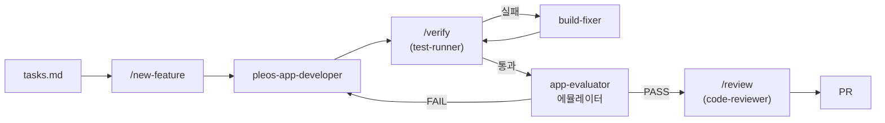

# Claude Code 하네스

이 저장소에서 Claude Code가 따르는 규칙, 스킬, 에이전트예요. 진입점은 [`CLAUDE.md`](../CLAUDE.md)이고, 흐름은 [개발 흐름](../docs/workflow.md)에 있어요.

## 에이전트 (`agents/`)

| 에이전트 | 하는 일 |
|---|---|
| `pleos-app-developer` | Kotlin + Compose + Pleos SDK로 앱 기능 구현 |
| `test-runner` | Gradle 빌드·테스트를 돌리고 실패만 보고 |
| `build-fixer` | 컴파일·의존성 오류를 최소 수정으로 고침 |
| `app-evaluator` | 에뮬레이터에 설치하고 Virtual Console로 신호를 넣어 스펙의 성공 기준(SC-*)을 PASS/FAIL로 확인 |
| `code-reviewer` | diff를 정확성·보안·컨벤션 기준으로 리뷰 |
| `explorer` | 코드베이스에서 파일·심볼 찾기 (읽기 전용) |
| `doc-writer` | 문서를 짧고 표·다이어그램 위주로 작성 |

## 스킬 (`skills/`)

| 분류 | 스킬 |
|---|---|
| 스펙 (Spec Kit) | `speckit-specify`, `speckit-clarify`, `speckit-plan`, `speckit-checklist`, `speckit-tasks`, `speckit-analyze`, `speckit-converge`, `speckit-constitution` |
| 구현·검증 | `new-feature`, `verify`, `review` |
| Pleos 지식 | `pleos-getting-started`, `pleos-vehicle-sdk`, `pleos-location-sdk`, `android-app-architecture` |
| 문서 | `markdown-docs` |

## 규칙 (`rules/`)

| 파일 | 내용 |
|---|---|
| `domain/android-kotlin-conventions.md` | Kotlin·Compose 코드 규칙 |
| `domain/android-security.md` | 앱 보안: 비밀 값, 데이터 최소화, 입력 검증 |
| `domain/pleos-vehicle-app.md` | Pleos 차량 앱 규칙: 지원 여부 확인, 주행 중 제한 |
| `global/security.md` | 공통 보안 기준 |

## 훅 (`hooks/`)

| 훅 | 하는 일 |
|---|---|
| `guard-main-commit.sh` | `main`에 커밋·푸시하거나 강제 푸시하는 것을 막아요 |
| `quiet-gradle.sh` | Gradle 출력을 줄여 실패만 보이게 해요 |
