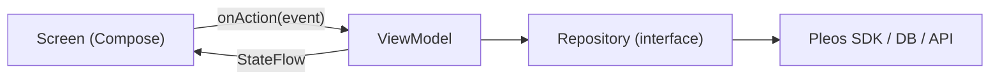

# Architecture with examples

Based on developer.android.com "Guide to app architecture" and the Now in Android reference app, reduced to a single-module app.

## Flow of one screen



## UI state

```kotlin
data class DriveUiState(
    val loading: Boolean = true,
    val socPercent: Int? = null,
    val restricted: Boolean = false,
    val error: UiError? = null,
)

sealed interface DriveAction {
    data object Refresh : DriveAction
    data class SetCabinTemp(val celsius: Float) : DriveAction
}
```

## ViewModel

```kotlin
@HiltViewModel
class DriveViewModel @Inject constructor(
    private val vehicle: VehicleRepository,
    carState: CarStateRepository,
) : ViewModel() {

    val uiState: StateFlow<DriveUiState> =
        combine(vehicle.batterySoc(), carState.isDrivingRestricted()) { soc, restricted ->
            DriveUiState(loading = false, socPercent = soc.valueOrNull(), restricted = restricted,
                error = (soc as? VehicleResult.Failure)?.toUiError())
        }.stateIn(viewModelScope, SharingStarted.WhileSubscribed(5_000), DriveUiState())

    fun onAction(action: DriveAction) {
        when (action) {
            DriveAction.Refresh -> Unit
            is DriveAction.SetCabinTemp -> viewModelScope.launch { vehicle.setCabinTemp(action.celsius) }
        }
    }
}
```

## Screen

```kotlin
@Composable
fun DriveRoute(viewModel: DriveViewModel = hiltViewModel()) {
    val state by viewModel.uiState.collectAsStateWithLifecycle()
    DriveScreen(state = state, onAction = viewModel::onAction)
}

@Composable
fun DriveScreen(state: DriveUiState, onAction: (DriveAction) -> Unit, modifier: Modifier = Modifier) {
    // stateless: renders state only, previewable and testable
}
```

The `Route` (stateful, gets the ViewModel) / `Screen` (stateless) split keeps previews and UI tests free of DI.

## Hilt wiring

```kotlin
@Module
@InstallIn(SingletonComponent::class)
object VehicleModule {
    @Provides @Singleton
    fun vehicle(@ApplicationContext context: Context): Vehicle =
        Vehicle(context).apply { initialize() }
}

@Module
@InstallIn(SingletonComponent::class)
abstract class RepositoryModule {
    @Binds abstract fun vehicleRepository(impl: PleosVehicleRepository): VehicleRepository
}

@Qualifier annotation class IoDispatcher

@Module
@InstallIn(SingletonComponent::class)
object DispatcherModule {
    @Provides @IoDispatcher fun io(): CoroutineDispatcher = Dispatchers.IO
}
```

## Navigation (type-safe)

```kotlin
@Serializable data object DriveDestination
@Serializable data class DetailDestination(val id: String)

NavHost(navController, startDestination = DriveDestination) {
    composable<DriveDestination> { DriveRoute(onOpen = { navController.navigate(DetailDestination(it)) }) }
    composable<DetailDestination> { entry -> DetailRoute(entry.toRoute<DetailDestination>().id) }
}
```

Naming: `XxxDestination` = serializable nav key, `XxxRoute` = stateful composable, `XxxScreen` = stateless composable.

## Java / Spring analogies (for reviewers coming from the backend)

| Android (Kotlin) | Closest backend concept |
|---|---|
| Composable `Screen` | View template rendered from a model |
| `ViewModel` | Application service scoped to one screen, survives re-creation |
| `StateFlow<UiState>` | An observable value; like a cached response that pushes updates |
| Repository interface + Pleos impl | Outbound port + adapter (hexagonal) |
| Hilt `@Module`/`@Provides`/`@Binds` | Spring `@Configuration`/`@Bean`/interface binding |
| `viewModelScope.launch {}` | Submitting a task to an executor that is cancelled when the screen closes |
| `suspend fun` | A method returning `CompletableFuture`, written as plain sequential code |
| `Flow` | Reactor `Flux` / a stream of events |
