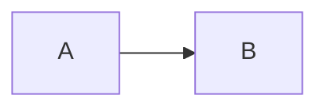

# Templates

Pick one type per doc (Diátaxis). Delete sections that don't apply; don't leave empty headings.

| Type | Reader's need | Shape |
|---|---|---|
| Tutorial | "Teach me by doing" | Numbered steps to one working result |
| How-to | "Help me do X" | Goal → prerequisites → steps → verify → troubleshoot |
| Reference | "Let me look up Y" | Tables, signatures, exact values; no narrative |
| Explanation | "Help me understand why" | Concept → diagram → trade-offs |

## README

````markdown
# <Project name>

<One sentence: what it is and who it's for.>

## Quick start

```bash
<the shortest path to something working>
```

## What's inside

| Path | Purpose |
|---|---|

## Docs

- [<Doc>](docs/<doc>.md) — <one line>
````

## How-to

````markdown
# <Do X>

<One line: the result the reader gets.>

## Before you start

- <prerequisite>

## Steps

1. <Imperative step.>

   ```bash
   <command>
   ```

2. <Next step.>

## Verify

<How the reader knows it worked.>

## Troubleshooting

| Symptom | Cause | Fix |
|---|---|---|
````

## Reference

```markdown
# <Thing> reference

<One line scope + version/date.>

## <Group>

| Name | Type | Description |
|---|---|---|
```

## Explanation

````markdown
# <Concept>

<Two-line summary of the idea and why it matters.>

## How it works

<One sentence on what to notice.>



## Trade-offs

| Option | Pros | Cons |
|---|---|---|
````

## Checklist

```markdown
# <Checklist name>

<When to use it.>

- [ ] <Verifiable item>
```

## Decision record

```markdown
# <Decision title>

- Date: <YYYY-MM-DD> · Status: <proposed | accepted | superseded>

## Decision
<One paragraph, conclusion first.>

## Options considered

| Option | Pros | Cons |
|---|---|---|

## Consequences
- <What changes>
```
