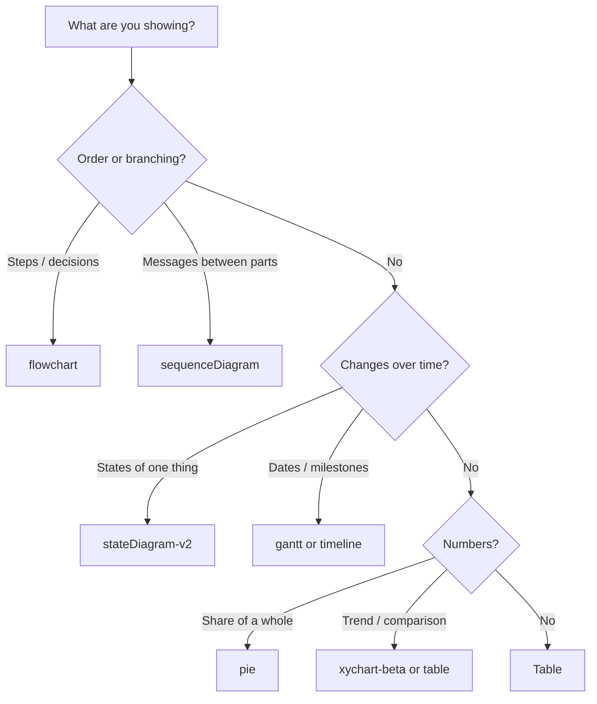
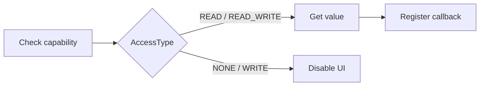
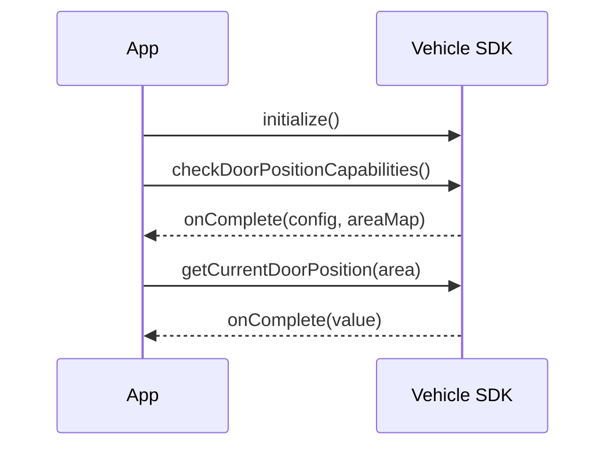
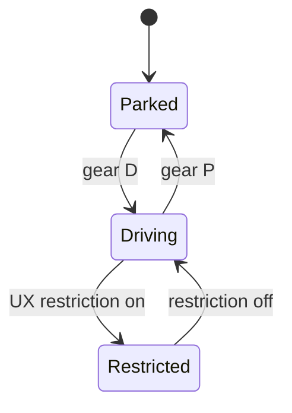
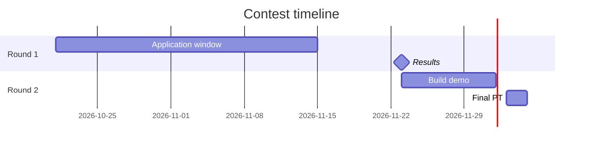
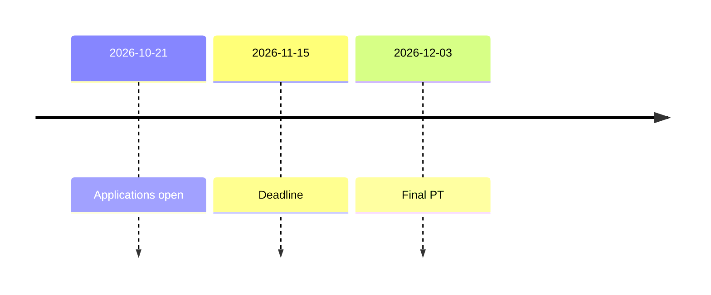
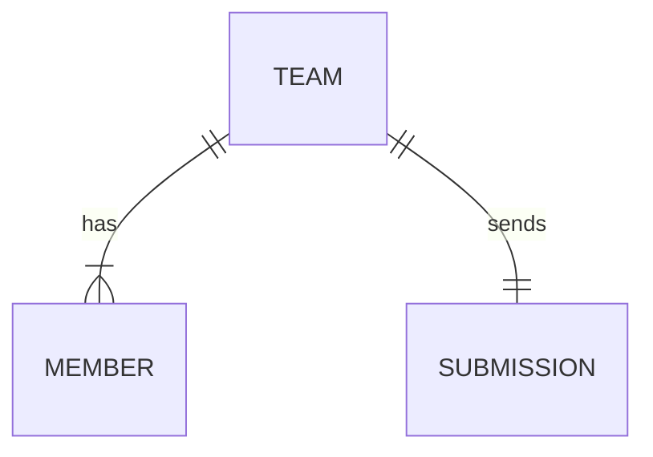
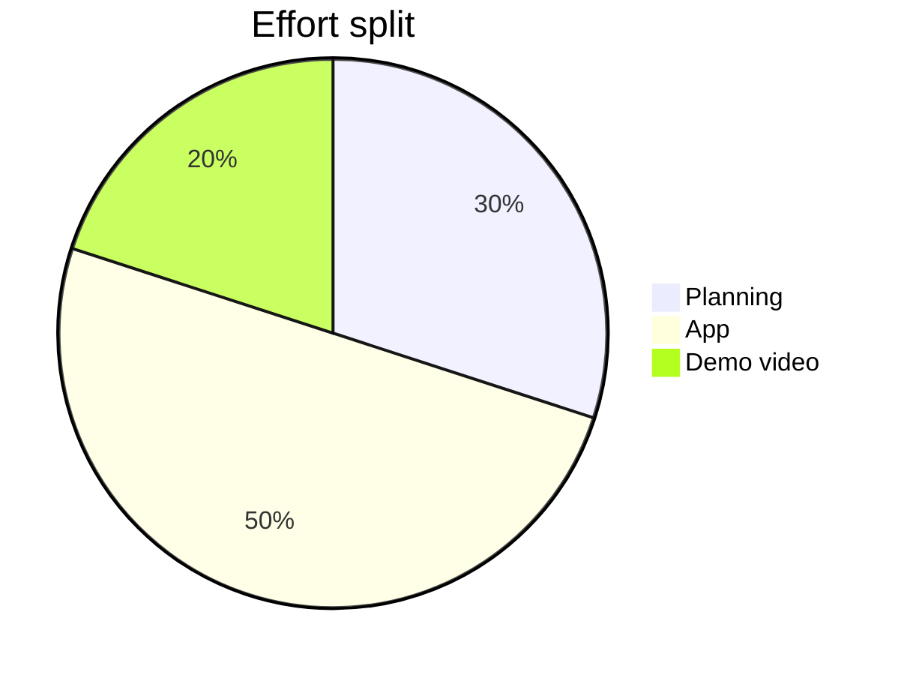
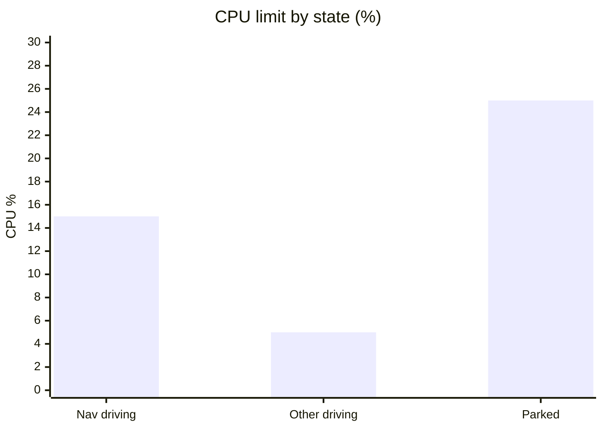
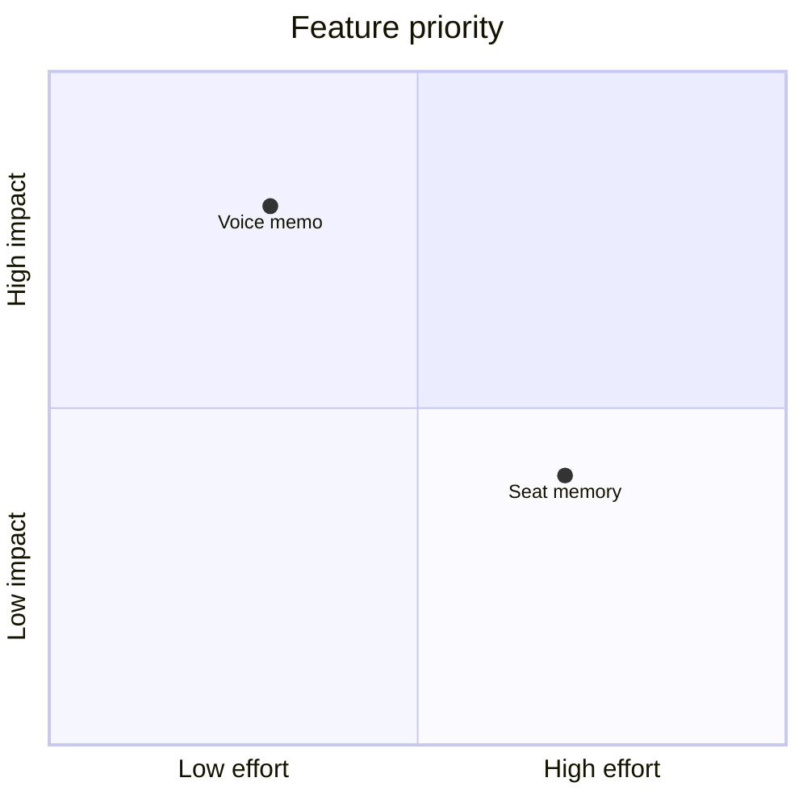

# Visuals: tables, Mermaid diagrams, charts

Use a visual when the reader would otherwise have to hold structure in their head. Mermaid renders natively on GitHub, GitLab, and most Markdown viewers (VS Code with the Mermaid extension, Obsidian, Notion import).

## Choosing the form

## Rules for every diagram

- One sentence before it: what the reader should notice.
- ≤ ~12 nodes and ≤ 2 crossing levels. Split big diagrams by phase.
- Short labels (≤ 5 words). Details go in text or a table below.
- Quote labels that contain spaces plus special characters, parentheses, or Korean punctuation: `A["설치 (선택)"]`.
- Top-down (`TD`) for processes, left-right (`LR`) for pipelines and timelines.
- No styling or colors unless they encode meaning; diagrams must read in light and dark themes.
- Don't use a diagram for a simple list of 3 things.

## Colours and shapes in this repository

Colour always means the same thing. These fills were checked in GitHub's light and dark themes; use them as written and add only the `classDef` lines a diagram needs, at its end. `README.md` and `docs/architecture.md` are the reference examples.

| Class | Meaning | Definition |
|---|---|---|
| `app` | app code | `classDef app fill:#1f6feb,stroke:#1158c7,color:#ffffff` |
| `domain` | pure Kotlin domain logic | `classDef domain fill:#8250df,stroke:#6639ba,color:#ffffff` |
| `pleos` | Pleos SDK that is integrated | `classDef pleos fill:#1a7f37,stroke:#116329,color:#ffffff` |
| `ext` | external service | `classDef ext fill:#bf5b04,stroke:#953800,color:#ffffff` |
| `config` | configuration file, secret store | `classDef config fill:#57606a,stroke:#424a53,color:#ffffff` |
| `plan` | planned, not connected, excluded or optional | `classDef plan fill:none,stroke:#8b949e,stroke-dasharray:5 4` |
| `now` | works today, in a diagram that contrasts today with the goal | `classDef now fill:#1f6feb,stroke:#1158c7,color:#ffffff` |

- Shapes: `id("…")` component or step, `id["…"]` file, `id{{"…"}}` interface, `id(["…"])` screen, `id{"…"}` decision.
- Subgraphs get `style <id> fill:none,stroke:#8b949e`. Unlinked nodes sit in a row with `direction LR` and `a ~~~ b ~~~ c`.
- When many nodes of two groups are linked, link the subgraphs instead; node-to-node links across groups make the layout tangle. A back edge from the last group to the first reorders the groups, so describe that loop in the sentence above the diagram.
- `sequenceDiagram`: `autonumber`, the driver is an `actor`, and a phase is a translucent block: `rect rgba(191, 91, 4, 0.14)` network, `rect rgba(130, 80, 223, 0.14)` pure computation, `rect rgba(26, 127, 55, 0.14)` Pleos SDK, `rect rgba(31, 111, 235, 0.14)` app.
- `stateDiagram-v2`: `direction LR`, ASCII ids with Korean names (`state "요약 카드" as summary`), no colours. `timeline` and `gitGraph`: no styling.
- No `%%{init}%%` or theme directive: GitHub picks the theme. A label line longer than about 14 Korean characters wraps in the middle of a word; break it with ` `.
- Say in the sentence above the diagram what the colours mean, or point to the legend table in `docs/architecture.md`.

## Templates

### Flow / decision

### Sequence

### State

### Schedule

`timeline` is lighter when there are no durations:

### Data model

### Numbers

### Priority

## Tables vs diagrams

| Situation | Prefer |
|---|---|
| Exact values the reader will look up | Table |
| Relationships, order, branching | Diagram |
| Both | Diagram for the shape, table for the values |

## Compatibility notes

- `xychart-beta`, `quadrantChart`, `timeline` need a recent Mermaid (GitHub supports them). If the target viewer is old, fall back to a table.
- Optional render check when Node.js is available: `npx -y @mermaid-js/mermaid-cli -i doc.md -o /tmp/out.md` (downloads the CLI; ask before running in restricted environments).
- For architecture pictures that Mermaid can't express cleanly, an ASCII tree in a `text` block is acceptable for directory layouts only.
