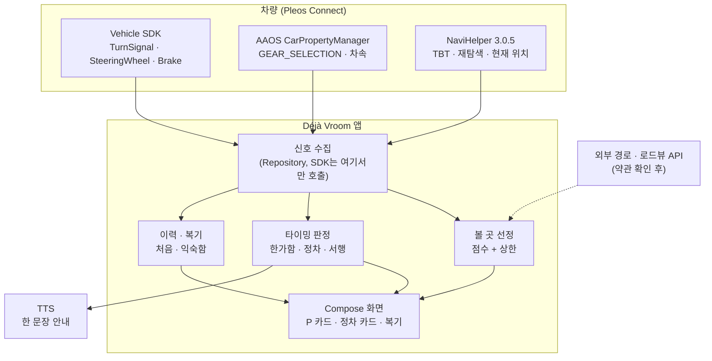

<div align="center">

# Déjà Vroom

**처음 가는 갈림길이, 이미 본 장면으로 다시 나온다.**

*Déjà vu(데자뷰) + Vroom(부릉)*

Pleos Connect(Android Automotive) 차량 앱 · 현대자동차그룹 차량용 앱 개발 공모전 출품작

[서비스](#서비스) · [시연 시나리오](docs/scenario.md) · [구성도](docs/architecture.md) · [코드 컨벤션](docs/conventions.md) · [Discussions](../../discussions)

</div>

> [!NOTE]
> **현재 상태: 기획과 에뮬레이터용 앱 프로토타입.** 아래 구현은 경로 미리보기 실험이며 Déjà Vroom의 Pleos 차량 기능이 완성된 상태는 아니다. Pleos 차량 신호와 NaviHelper는 아직 연결되지 않았다.

## 이름

| | |
|---|---|
| 이름 | **Déjà Vroom** (데자 부룸) |
| 말장난 | *Déjà vu*(이미 본 것 같은 느낌) + *Vroom*(부릉, 차 소리) |
| 뜻 | 처음 가는 갈림길을 1 km 전에 미리 듣고 신호 대기 때 한 장 보기 때문에, 도착하면 **이미 본 장면**이 된다 |

## 서비스

처음 가는 길이 부담스러운 운전자는 출발 전에 로드뷰로 경로를 훑는다. 그러나 회전 스무 개를 다 외울 수는 없고, 두 시간 뒤 열두 번째 교차로는 기억에 남지 않는다. 가장 헷갈리는 도착지 주차장 입구는 로드뷰에 나오지도 않는다.

Déjà Vroom은 **외우게 하지 않는다.** 볼 곳은 차가 고르고, 필요한 순간에만 꺼낸다.


| 기능 | 방법 | 쓰는 차량 신호 |
|---|---|---|
| **고른다** | 경로의 회전 중 처음 가는 곳, 틀리면 크게 돌아가는 곳, 입구를 지나치기 쉬운 곳만 고른다 | 주행 이력, NaviHelper 재탐색 이벤트 |
| **꺼낸다** | 1 km 전 한가한 순간(지시등 OFF, 조향 작음, 다음 안내 300 m 초과)에 한 문장. 정차 중에는 사진 한 장 | 지시등, 조향각, 브레이크, 기어, 차속 |
| **줄인다** | 도착 뒤 지점별로 "지시등을 켜고 차선을 바꾸기까지 걸린 시간"을 보여 주고, 익숙해진 곳은 다음부터 안내하지 않는다 | 지시등·조향 타임라인 |

**하지 않는 것:** 내비가 이미 안내하는 사고다발·스쿨존·단속카메라를 반복하지 않는다. 상태 대신 행동을 안내한다("사고 많은 곳" ✕ → "지금 2차로, 왼쪽은 유턴 전용" ○). 아는 길에서는 안내하지 않는다. 속도와 급제동은 기록하지 않는다. 운전 점수가 아니라 **경로에 익숙해지는 정도**를 보여 준다.

자세한 규칙: [서비스 컨셉](docs/concept.md) · 장면별 흐름: [시연 시나리오](docs/scenario.md)

## 실행 방법

> [!IMPORTANT]
> 앱은 Pleos Connect Emulator 또는 Android 에뮬레이터에서 실행한다. 앱은 외부 네트워크를 사용한다.

```bash
git clone https://github.com/JoisFe/deja-vroom.git
cd deja-vroom
./gradlew :app:assembleDebug        # 디버그 빌드
./gradlew :app:testDebugUnitTest    # 단위 테스트
./gradlew :app:installDebug         # 실행 중인 에뮬레이터에 설치
```

현재 앱은 출발지와 목적지를 직접 입력해 Nominatim/OSRM 경로를 미리 보고, 선택한 후보의 Kakao Roadview를 여는 프로토타입이다. 출발지 초기값은 수원시 영통구이며 직접 바꿀 수 있다. 실차 위치와 Pleos 내비 경로를 쓰지 않는다. Roadview 사용 전에는 `local.properties`의 Kakao JavaScript 키 설정과 Roadview 로컬 서버 실행이 필요하다. 자세한 실행 방법은 `scripts/roadview/serve.sh`를 참고한다. 최종 Déjà Vroom 시연 목표는 [시연 시나리오](docs/scenario.md)에 있다.

## 테스트 환경과 필요한 설정

| 항목 | 값 |
|---|---|
| 에뮬레이터 | Pleos Connect Emulator 2.1.0, Android API 34 시스템 이미지 |
| 차량 신호 입력 | Pleos Virtual Console (Gear, ACCEL, Brake, Steering, Turn Signal, 내비 TBT 주입) |
| 앱 | Kotlin, Jetpack Compose, minSdk 28 |
| 빌드 | Gradle Wrapper (`./gradlew`), Gradle 실행 JDK 17 또는 21 |
| Pleos SDK | Vehicle, NaviHelper 3.0.5, TextToSpeech. Pleos Playground 프로젝트 승인 필요 |
| 비밀 값 | Demo 모드는 필요 없다. 실제 연동 시 `secrets.properties`(git 제외)에 둔다 |

## APK

| 항목 | 위치 |
|---|---|
| release APK | [`apk/`](apk/) 폴더 (파일명 규칙 `팀명_앱이름_release.apk`, 업로드 예정) |
| 100 MB 초과 시 | [GitHub Releases](../../releases) |

## 구성도



계층, SDK 매핑, 한계는 [구성도 문서](docs/architecture.md)에 있다.

## 문서

| 문서 | 내용 |
|---|---|
| [서비스 컨셉](docs/concept.md) | 문제, 해법, 볼 곳 선정 규칙, 하지 않는 것 |
| [시연 시나리오](docs/scenario.md) | 일곱 장면과 Virtual Console 시연 순서(7분) |
| [구성도](docs/architecture.md) | 앱 계층, Pleos SDK·API 매핑, 알려진 한계 |
| [코드 컨벤션](docs/conventions.md) | Kotlin·Compose 규칙, 브랜치·커밋·PR |
| [개발 흐름](docs/workflow.md) | Spec Kit 스펙 → Claude Code 하네스 구현 → 에뮬레이터 검증 |
| [제출물 체크리스트](docs/submission.md) | 공모전 제출물, 블라인드 점검, 라이선스 |
| [Claude Code 하네스](.claude/README.md) | 이 저장소의 에이전트·스킬·규칙 |

## 개발 방식

스펙은 [GitHub Spec Kit](https://github.com/github/spec-kit)(한국어 템플릿)으로 작성하고, 구현과 검증은 [Claude Code](https://claude.com/claude-code) 하네스로 한다. 완료 기준은 빌드·테스트 통과 **그리고** 에뮬레이터에서 스펙의 성공 기준 확인이다. 원칙은 [헌법](.specify/memory/constitution.md)에 있다.

```text
/speckit-specify → /speckit-clarify → /speckit-plan → /speckit-tasks
        → /new-feature → pleos-app-developer → /verify → app-evaluator → 리뷰 → PR
```

## 질문과 피드백

[Discussions](../../discussions)에 소개, 컨셉, 코드 컨벤션, 시연 영상, 로드맵이 있다. 버그와 기능 제안은 [Issues](../../issues)에 남긴다.
