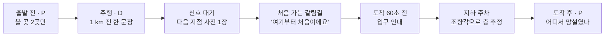
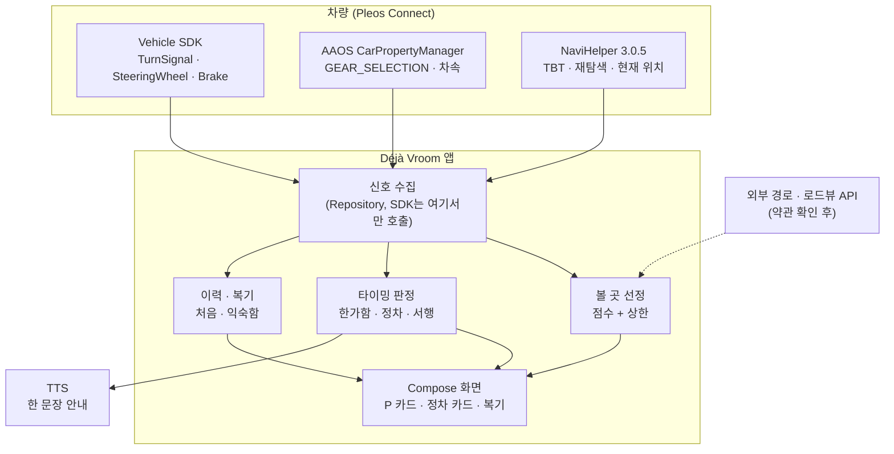

<div align="center">

# Déjà Vroom

**처음 가는 갈림길이, 이미 본 장면으로 다시 나와요.**

*Déjà vu(데자뷰) + Vroom(부릉)*

Pleos Connect(Android Automotive) 차량 앱 · 현대자동차그룹 차량용 앱 개발 공모전 출품작

[서비스](#서비스) · [시연 시나리오](docs/scenario.md) · [구성도](docs/architecture.md) · [코드 컨벤션](docs/conventions.md) · [Discussions](../../discussions)

</div>

> [!NOTE]
> **현재 상태: 기획·하네스와 개발 프로토타입.** 저장소에는 출발지·목적지 기반 경로 분석과 Roadview 확인을 위한 FirstLook 프로토타입이 포함돼 있습니다. 이는 Déjà Vroom의 최종 차량 기능을 구현한 앱이 아니며, Pleos 차량 신호·실차 경로·운전 중 UX는 아직 연결되지 않았습니다. 제안 단계 기능과 동작 확인된 프로토타입 범위를 각 문서에서 구분합니다.

## 이름

| | |
|---|---|
| 이름 | **Déjà Vroom** (데자 부룸) |
| 말장난 | *Déjà vu*(이미 본 것 같은 느낌) + *Vroom*(부릉, 차 소리) |
| 우리 얘기 | 처음 가는 갈림길인데, 1 km 전에 차가 미리 들려주고 신호 대기 때 한 장 보여 줘서 **도착하면 이미 본 장면**이 돼요 |

## 서비스

처음 가는 길이 무서운 사람은 출발 전에 로드뷰로 경로를 훑어봐요. 그런데 회전 스무 개를 다 외울 수는 없고, 두 시간 뒤 열두 번째 교차로는 기억에 남지 않아요. 가장 무서운 도착지 주차장 입구는 로드뷰에 나오지도 않고요.

Déjà Vroom은 **외우게 하지 않아요.** 볼 곳은 차가 고르고, 필요한 순간에만 꺼내 줘요.



| 무엇을 | 어떻게 | 차만 아는 신호 |
|---|---|---|
| **고른다** | 경로의 회전 중 내가 처음 가는 곳, 틀리면 크게 돌아가는 곳, 입구를 지나치기 쉬운 곳만 고름 | 내 주행 이력, NaviHelper 재탐색 이벤트 |
| **꺼낸다** | 1 km 전, 한가한 순간(지시등 OFF, 조향 작음, 다음 안내 300 m 넘게 남음)에 한 문장. 멈췄을 때 사진 한 장 | 지시등, 조향각, 브레이크, 기어, 차속 |
| **줄인다** | 도착 뒤 지점별로 "깜빡이를 켜고 차선을 바꾸기까지 몇 초"를 보여 주고, 익숙해진 곳은 다음부터 말하지 않음 | 지시등과 조향의 타임라인 |

**하지 않는 것:** 내비가 이미 하는 말(사고다발, 스쿨존, 단속카메라)은 반복하지 않아요. 상태 대신 행동을 말해요("사고 많은 곳" ✕ → "지금 2차로, 왼쪽은 유턴 전용" ○). 아는 길에서는 침묵해요. 속도와 급제동은 기록하지 않아요. 운전 점수가 아니라 **익숙해지는 정도**를 보여 주는 앱이에요.

자세한 규칙: [서비스 컨셉](docs/concept.md) · 장면별 흐름: [시연 시나리오](docs/scenario.md)

## 실행 방법

> [!IMPORTANT]
> 아래 앱은 FirstLook 경로 분석 프로토타입입니다. Déjà Vroom의 차량 신호 기반 안내는 아직 구현되지 않았습니다.

```bash
git clone https://github.com/JoisFe/deja-vroom.git
cd deja-vroom
./gradlew :app:assembleDebug        # 디버그 빌드
./gradlew :app:testDebugUnitTest    # 단위 테스트
./gradlew :app:installDebug         # 실행 중인 에뮬레이터에 설치
```

현재 route preview는 외부 공개 개발 서비스(Nominatim·OSRM·Kakao Roadview)를 사용하고 네트워크 연결이 필요해요. 실제 차량 위치·Pleos NaviHelper·Vehicle 신호를 사용하지 않으므로 실차 주행 기능으로 간주하지 않습니다. 제품 방향과 Virtual Console 기반 시연 목표는 [시연 시나리오](docs/scenario.md)에 정리했습니다.

### 현재 구현된 경로 미리보기 프로토타입

출발지와 목적지를 직접 입력하면 각각 지오코딩한 뒤 실제 도로 geometry/분기 데이터를 분석해 복잡 구간 후보를 보여줍니다. 후보를 선택하면 Kakao Roadview를 열고, 화면 안에서 이전·다음 후보로 이동할 수 있습니다. 출발지 초기값은 `수원시 영통구`지만 수정할 수 있습니다. 현재 위치 자동 감지는 연결하지 않았습니다. Roadview에는 경로 진행 방향 화살표가 표시되며, 차로 데이터가 없는 경우 특정 차선을 추정하지 않습니다.

상세 실행·API 키 설정·검증 범위는 [프로토타입 구현 가이드](docs/firstlook/implementation-guide.md)와 [구현 상태 보고서](docs/firstlook/kakao-roadview-implementation-status.md)를 참고하세요. Kakao JS 키 및 Mapillary 토큰은 개발자 로컬 `local.properties`에만 둡니다.

## 테스트 환경과 필요한 설정

| 항목 | 값 |
|---|---|
| 에뮬레이터 | Pleos Connect Emulator 2.1.0, Android API 34 시스템 이미지 |
| 차량 신호 입력 | Pleos Virtual Console (Gear, ACCEL, Brake, Steering, Turn Signal, 내비 TBT 주입) |
| 앱 | Kotlin, Jetpack Compose, minSdk 28 |
| 빌드 | Gradle Wrapper (`./gradlew`), Gradle 실행 JDK 17 또는 21 |
| Pleos SDK | Vehicle, NaviHelper 3.0.5, TextToSpeech. Pleos Playground 프로젝트 승인 필요 |
| 비밀 값 | Demo 모드는 필요 없어요. 실제 연동 시 `secrets.properties`(git 제외)에 넣어요 |

## APK

| 항목 | 위치 |
|---|---|
| release APK | [`apk/`](apk/) 폴더 (공모전 규칙에 따른 파일명 `팀명_앱이름_release.apk`, 업로드 예정) |
| 용량이 100 MB를 넘을 때 | [GitHub Releases](../../releases) |

## 구성도



계층, SDK 매핑, 한계는 [구성도 문서](docs/architecture.md)에 있어요.

## 문서

| 문서 | 내용 |
|---|---|
| [서비스 컨셉](docs/concept.md) | 문제, 해법, 볼 곳 고르는 규칙, 하지 않는 것 |
| [시연 시나리오](docs/scenario.md) | 일곱 장면과 Virtual Console 시연 순서(7분) |
| [구성도](docs/architecture.md) | 앱 계층, Pleos SDK·API 매핑, 알려진 한계 |
| [코드 컨벤션](docs/conventions.md) | Kotlin·Compose 규칙, 브랜치·커밋·PR |
| [개발 흐름](docs/workflow.md) | Spec Kit 스펙 → Claude Code 하네스 구현 → 에뮬레이터 검증 |
| [제출물 체크리스트](docs/submission.md) | 공모전 제출물, 블라인드 점검, 라이선스 |
| [Claude Code 하네스](.claude/README.md) | 이 저장소의 에이전트·스킬·규칙 |
| [경로 미리보기 구현 가이드](docs/firstlook/implementation-guide.md) | 현재 앱의 실행, 경로 후보 분석, Roadview와 검증 경계 |
| [FirstLook 프로토타입 스펙](specs/001-firstlook-real-road-briefing/spec.md) | 구현·검증 이력과 현재 프로토타입 범위 |

## 개발 방식

스펙은 [GitHub Spec Kit](https://github.com/github/spec-kit)(한국어 템플릿)으로 쓰고, 구현과 검증은 [Claude Code](https://claude.com/claude-code) 하네스로 해요. "완료"는 빌드·테스트 통과 **그리고** 에뮬레이터에서 스펙의 성공 기준을 확인한 상태예요. 원칙은 [헌법](.specify/memory/constitution.md)에 있어요.

```text
/speckit-specify → /speckit-clarify → /speckit-plan → /speckit-tasks
        → /new-feature → pleos-app-developer → /verify → app-evaluator → 리뷰 → PR
```

## 질문과 피드백

[Discussions](../../discussions)에 소개, 코드 컨벤션, 시연 영상, 로드맵을 올려 두었어요. 버그와 기능 제안은 [Issues](../../issues)에 남겨 주세요.
