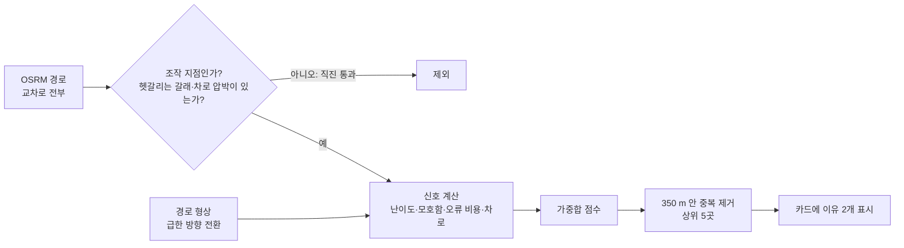

# 볼 곳 선정 알고리즘

경로에서 "처음 가는 운전자가 놓치면 가장 후회할 곳"을 최대 5곳 고른다. 코드: `domain/ManeuverScorer.kt`, `domain/RouteCandidateDetector.kt`, `domain/RouteAnalyzer.kt`.

## 흐름

## 제외 규칙

OSRM의 한 step에서 운전자가 실제로 조작하는 곳은 첫 교차로뿐이다. 나머지 교차로는 직진으로 지나간다. 다음 세 가지가 모두 없으면 후보에서 뺀다.

- 조작 지점에서의 회전·분기 (직진·`continue`·`new name`은 조작이 아니다)
- 진행 방향과 30° 이내의 다른 진입 가능 갈래
- 차로 3개 이상 중 절반 이하만 진행 방향인 차로 압박

## 신호와 가중치

| 신호 | 가중치 | 값 (0~1) | 카드에 보이는 이유 |
|---|---|---|---|
| 난이도 | 0.25 | 유턴 1.0, 급회전 0.9, 좌회전·회전교차로 0.7, 분기·램프 0.6, 우회전 0.4, 직진 0 | "좌회전", "유턴", "급회전" |
| 모호함 | 0.20 | 30° 이내 다른 갈래 1개 0.7, 2개 이상 1.0 | "비슷한 방향 갈래 2개" |
| 오류 비용 | 0.25 | 고속도로·자동차전용도로 램프·분기 1.0, 고속도로 기타 0.8, 회전교차로·일반 분기 0.6, 도심 회전 0.2 | "진출로: 놓치면 되돌리기 어려움" |
| 차로 압박 | 0.10 | 1 − (진행 방향 차로 수 ÷ 전체 차로 수) | "차로 4개 중 1개만 진행 방향" |
| 연속 조작 | 0.05 | 300 m 안 다른 조작 수 ÷ 2 | "300m 안에 조작 3회" |
| 목적지 근접 | 0.10 | 경로 85% 이후부터 1.0까지 증가 | – |
| 과거 사고 | 0.05 | 공공데이터 연동 시 | "과거 사고 이력 신호 · 현재 위험도 의미 아님" |

경로 형상만으로 찾은 급한 방향 전환은 교차로인지 도로 굽이인지 모르기 때문에 난이도에 0.6을 곱한다. 데이터 신뢰도와 로드뷰 유무는 순위에 쓰지 않는다.

## 이전 방식과 차이

| | 이전 | 지금 |
|---|---|---|
| 후보 | 진입 가능 갈래 3개 이상인 교차로 전부 (직진 통과 포함) | 조작 지점 + 헷갈리는 갈래 + 차로 압박만 |
| 조작 종류 | step의 조작을 step 안 모든 교차로에 적용 | 첫 교차로에만 적용 |
| 점수 | 갈래 수·회전 각도·데이터 신뢰도 | 난이도·모호함·오류 비용·차로 압박 |
| 결과 | 크게 직진하는 사거리가 실제 좌회전과 비슷한 점수 | 직진 통과는 제외, 램프·분기가 우선 |

## 아직 모르는 것

| 신호 | 지금 | 연결 방법 |
|---|---|---|
| 처음 가는 곳 (주행 이력) | 없음 | 기기에 지나간 교차로 좌표를 저장하고, 0회면 1.0, 1~2회 0.5, 3회 이상 0을 신호로 더한다 |
| 실측 망설임 | 없음 | Vehicle SDK 지시등·조향 타임라인으로 "지시등 → 차선 변경" 시간을 재고, 익숙해진 곳의 점수를 내린다 |
| 실제 우회 시간 | 도로 등급으로 추정 | 틀린 갈래 끝에서 목적지까지 재경로(`requestTrip` 또는 외부 경로 API)를 계산해 오류 비용을 분 단위로 바꾼다 |
| Pleos 내비 경로와 일치 | 외부 경로(OSRM) 기준 | NaviHelper TBT가 올 때마다 다시 판정한다 |
