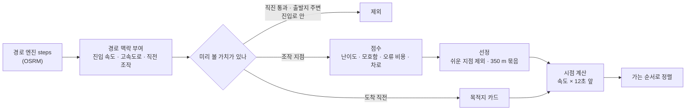

# 볼 곳 선정 알고리즘

경로에서 "처음 가는 운전자가 놓치면 가장 후회할 곳"을 고르고, 각 지점을 **분기점에 닿기 전 시점**에서 보여 준다. 카드는 목적지 카드를 포함해 최대 5장이고, 화면에는 출발지에서 가까운 순서로 놓인다.

| 역할 | 코드 |
|---|---|
| 조작 하나의 판단 (조작인가, 얼마나 어렵고 비싼가) | `domain/Maneuver.kt` |
| 경로 맥락 (진입 속도, 고속도로 여부, 출발·도착 진입로) | `domain/TurnByTurnRoute.kt` |
| 선정 (제외, 점수, 묶음, 목적지 카드, 순서) | `domain/RouteAnalyzer.kt` |
| 시점 (얼마나 앞에서 보여 줄지) | `domain/ApproachPolicy.kt`, `domain/RoutePolyline.kt` |
| 조정 값 | `config/briefing.yml` → `data/BriefingSettings.kt` |

## 흐름

## 제외 규칙

| 제외하는 것 | 이유 |
|---|---|
| 직진으로 지나가는 교차로 | 조작이 없다. 고속도로에서 비슷한 방향 갈래를 지나는 경우만 약한 후보로 남긴다 |
| `depart`, `arrive`, `new name`, 직진 `continue` | 도로가 시작·끝나거나 이름만 바뀐다. 고를 것이 없다 |
| 출발 진입로와 그 출구 | 이름 없는 길(주차장, 진입로)로 시작하는 구간이다. 운전자가 이미 서 있는 곳이다 |
| 출발지 300 m 이내 | 출발지 주변은 운전자가 아는 유일한 곳이다 |
| 도착 진입로 안쪽의 조작 | 따로 보여 주지 않고 목적지 카드 한 장으로 묶는다 |
| 경로 모양만으로 찾은 꺾임 | 주차장 안 굽이와 도로 굽이를 조작으로 착각한다. 조작 정보가 없는 경로에서만 쓴다 |
| 점수 0.2 미만 | 단순 우회전, 합류 같은 쉬운 지점으로 칸을 채우지 않는다. 1위는 예외다 |

## 신호와 가중치

점수는 각 신호(0~1)에 가중치를 곱해 더한 값이다.

| 신호 | 가중치 | 값 | 카드에 보이는 이유 |
|---|---|---|---|
| 난이도 | 0.25 | 유턴 1.0, 급회전 0.9, 좌회전·회전교차로 0.7, 분기·램프 0.6, 완만한 방향 전환 0.5, 우회전 0.4, 합류 0.3 | "좌회전", "유턴", "본선 합류" |
| 모호함 | 0.20 | 진출 방향 30° 안의 다른 갈래 1개 0.7, 2개 이상 1.0 | "비슷한 방향 갈래 2개" |
| 오류 비용 | 0.25 | 고속도로 진출·고속도로 갈림길 1.0, 일반 진출로 0.8, 진입로 0.7, 회전교차로·일반 갈림길 0.6, 도심 회전 0.2, 합류 0.1 | "진출로: 놓치면 되돌리기 어려움" |
| 차로 압박 | 0.10 | 1 − (진행 방향 차로 수 ÷ 전체 차로 수) | "차로 4개 중 1개만 진행 방향" |
| 연속 조작 | 0.05 | 300 m 안 다른 조작 수 ÷ 2 | "300m 안에 조작 3회" |
| 목적지 근접 | 0.10 | 경로 85% 이후부터 1.0까지 증가 | – |
| 과거 사고 | 0.05 | 공공데이터 연동 시 | "과거 사고 이력 신호" |

- **고속도로급 판정**: 도로 등급(motorway·trunk), 이름("고속도로", "고속화도로"), 경로 엔진 속도 70 km/h 이상(300 m 이상 구간) 중 하나에 해당하면 고속도로급으로 본다.
- **고속도로 방향 선택**: 갈림길 바로 다음에 고속도로로 합류하면(1.5 km 이내) 그 갈림길도 오류 비용 1.0이다. 나들목 안에서 서울 방향과 부산 방향을 가르는 곳이 여기에 해당한다.
- **표지**: 지도 데이터에 기록된 방면 표지가 있으면 이유 둘째 줄에 "표지: 양재"처럼 보여 준다. 노선 번호는 빼고 방면 두 개까지만 쓴다.

## 시점: 얼마나 앞에서 보여 주나

로드뷰는 분기점 위가 아니라 그 앞에서 시작한다. 분기점에서 차로를 고르면 이미 늦기 때문이다.

| 상황 | 시작 지점 |
|---|---|
| 기본 | 진입 도로 속도 × 12초. 최소 70 m, 최대 350 m |
| 고속도로급 도로 | 최소 300 m. 표지와 감속차로가 일찍 시작한다 |
| 진입 속도를 모를 때 | 150 m |
| 직전 조작이 그보다 가까울 때 | 직전 조작을 지난 직후(15 m 뒤). 그 전 도로에서는 분기점이 보이지 않는다 |
| 도착 지점 | 80 m. 운전자가 속도를 줄이고 찾는 구간이다 |

시점의 방향은 그 지점의 진행 방향이다. 로드뷰 페이지는 시점에서 파노라마를 열고, 분기점 위치에 "!" 표시를 둔다.

### 자동 재생

시점에서 멈춰 있지 않고, 분기점을 지나 나가는 방향이 보일 때까지 앞으로 간다. 운전하듯 사진이 한 장씩 넘어간다.

| 항목 | 값 |
|---|---|
| 구간 | 시점 → 분기점 → 분기점 60 m 뒤. 도착 지점은 도착점에서 끝난다 |
| 간격 | 약 20 m마다 한 장. 접근 구간이 길면 간격을 넓혀 10번 안에 끝낸다 |
| 방향 | 각 사진에서 경로의 진행 방향. 분기점을 지나면 나가는 길 쪽으로 돈다 |
| 안내 띠 | 남은 거리가 "300m 앞 → 150m 앞 → …"으로 줄어든다. 도로 위 화살표로 직접 이동해도 사진 위치에 맞춰 바뀐다 |
| 조작 | 화면을 만지면 멈춘다. 왼쪽 아래 버튼으로 다시 본다 |

| 실제 경로의 예 | 진입 속도 | 시작 지점 |
|---|---|---|
| 경부고속도로 진출로(양재) | 88 km/h | 300 m 전 |
| 중부대로 갈림길(수원신갈IC) | 56 km/h | 186 m 전 |
| 양재대로 → 강남대로 좌회전 | 42 km/h | 140 m 전 |
| 도착 지점(강남역) | – | 80 m 전 |

## 선정과 순서

1. 점수가 높은 순으로 고른다. 350 m 안에서 이어지는 조작은 카드 한 장으로 묶는다.
2. 묶인 조작의 점수가 비슷하면(차이 0.05 미만) **먼저 만나는 지점**을 카드로 쓴다. 첫 조작을 놓치면 다음 조작은 의미가 없다.
3. 목적지 카드는 항상 넣는다. 순위는 가장 중요한 분기점 다음인 2위다.
4. 화면에는 **가는 순서**로 놓는다. 순위는 `selectionRank`에 남고, "3개" 보기는 순위 3위까지를 가는 순서로 보여 준다.

### 목적지 카드

| 경로의 끝 모양 | 카드가 시작하는 곳 |
|---|---|
| 이름 없는 진입로로 끝난다 (공항, 주차장) | 마지막 큰길에서 진입로로 빠지는 지점 |
| 도착 300 m 안에 조작이 있다 | 그 가운데 첫 조작 |
| 큰길 위에서 끝난다 | 도착 지점 80 m 앞. "목적지는 진행 방향 오른쪽"을 함께 보여 준다 |

## 화면에 보이는 것

점수와 좌표, 선정 과정은 운전자에게 보여 주지 않는다. 화면에는 "어디서, 어느 쪽으로, 무엇을 보고"만 남긴다.

| 화면 | 보이는 것 | 예 |
|---|---|---|
| 카드 | 방향 화살표, 지점 이름, 한 줄(조작 · 표지), 사진이 찍힌 거리 | ↗ 경부고속도로 진출로 / 오른쪽 진출로 · 표지 양재 / 300m 전 |
| 로드뷰 | 사진 위 안내 띠: 화살표, 거리와 조작, 표지 | ↗ 300m 앞 · 오른쪽 진출로 / 표지 양재 |
| 주행 시작 | 미리 본 지점을 가는 순서로 정리한 목록 | 출발 후 30.0km · 오른쪽 진출로 · 표지 양재 |

화살표 방향은 계산한 경로가 그 지점에서 실제로 꺾이는 방향이다. 차로 번호는 확인된 데이터가 없으면 말하지 않는다.

## 조정 값

시연하면서 바꿔 볼 값은 `config/briefing.yml`에 있다. 고치고 다시 빌드하면 적용된다. 숫자가 아닌 값, 범위를 벗어난 값, 모르는 키가 있으면 앱은 전체를 기본값으로 되돌리고 로그를 남긴다. 저장소에 올린 파일은 단위 테스트가 검사한다.

| 구역 | 키 | 기본값 |
|---|---|---|
| `selection` | `maxCards`, `minimumScore`, `duplicateDistanceMeters` | 5, 0.2, 350 |
| | `departureGuardMeters`, `arrivalZoneMeters`, `nearTieScore` | 300, 300, 0.05 |
| `weights` | `complexity`, `ambiguity`, `errorCost`, `lanePressure` | 0.25, 0.20, 0.25, 0.10 |
| | `maneuverDensity`, `destinationProximity`, `historicIncident` | 0.05, 0.10, 0.05 |
| `approach` | `leadSeconds`, `minLeadMeters`, `maxLeadMeters` | 12, 70, 350 |
| | `highwayMinLeadMeters`, `defaultLeadMeters`, `arrivalLeadMeters` | 300, 150, 80 |
| | `driveStepMeters`, `drivePastMeters`, `driveMaxSteps` (자동 재생) | 20, 60, 10 |
| `maneuver` | `lookAlikeAngleDegrees`, `highwaySpeedKmh` | 30, 70 |

| 상수로 둔 것 | 이유 |
|---|---|
| 조작 종류별 난이도·오류 비용 표 | 값마다 근거가 있고 테스트가 그 순서를 고정한다. 코드와 함께 읽어야 한다 |
| 경로 엔진 용어(`off ramp`, `fork` 등), 표지 정리 규칙 | 데이터 형식이다. 취향으로 바꾸는 값이 아니다 |
| 경로 일치 검증 오차, 진입로·연결로 길이 한도 | 정확성을 지키는 값이다. 잘못 바꾸면 틀린 지점이 통과한다 |
| 지구 반지름, 방향 계산 구간 | 정의다 |

## 실제 경로로 확인한 결과

OSRM 공개 서버의 실제 응답으로 돌린 결과다(2026-11-15). 기본 출발지·목적지인 수원시 영통구 → 강남역 경로다.

| 가는 순서 | 지점 | 순위 | 시점 | 이유 |
|---|---|---|---|---|
| 1 | 중부대로 갈림길 (5.2 km) | 4 | 186 m 전 | 비슷한 방향 갈래 2개 · 표지: 수원신갈IC·신갈 |
| 2 | 영덕교 갈림길 (6.0 km) | 3 | 150 m 전 | 고속도로 갈림길: 잘못 들면 되돌리기 어려움 · 표지: 서울·신갈분기점 |
| 3 | 경부고속도로 진출로 (30.0 km) | 1 | 300 m 전 | 진출로: 놓치면 되돌리기 어려움 · 표지: 양재 |
| 4 | 양재대로 → 강남대로 (30.5 km) | 5 | 140 m 전 | 좌회전 |
| 5 | 도착 지점 (34.8 km) | 2 | 80 m 전 | 목적지는 진행 방향 오른쪽 |

| | 이전 | 지금 |
|---|---|---|
| 출발점(구청 주차장 쪽) | 후보 5곳에 포함 | 제외 |
| 도착점 | 일반 후보로 포함, 분기점 위 시점 | 목적지 카드, 80 m 앞 시점 |
| 양재대로 → 강남대로 좌회전 | 빠짐 | 포함 |
| 고속도로 방향을 가르는 갈림길 | 빠짐 | 포함 |
| 로드뷰 시점 | 분기점 위에서 빠져나가는 방향 | 분기점 80~300 m 앞에서 진행 방향 |

좌회전이 빠졌던 원인은 경로 일치 검증이었다. 꺾이는 지점에서는 들어오는 선분과 나가는 선분이 똑같이 가까운데, 그중 하나만 보고 방향을 비교해서 45° 넘게 꺾이는 회전이 탈락했다. 지금은 두 선분 중 하나와 맞으면 통과한다.

## Pleos SDK 연결 지점

지금은 외부 데이터로 돌아간다. 각 단계에서 Pleos SDK·API로 바꿀 자리는 다음과 같다.

| 단계 | 지금 | Pleos로 바꿀 것 |
|---|---|---|
| 출발지 | 직접 입력 | NaviHelper `getCurrentLocationInfo` |
| 목적지·경로 | 직접 입력 + OSRM | NaviHelper `getDestinationInfo`, `requestRoute`. 주행 중에는 `onTBTInfo`가 올 때마다 다시 판정 |
| 진입 속도 | 경로 엔진의 구간 속도 | 차속(AAOS `PERF_VEHICLE_SPEED`)으로 시점 거리를 실시간 계산 |
| 꺼내는 순간 | 출발 전 카드뿐 | TBT 남은 거리가 시점 거리와 같아질 때 Pleos TTS로 한 문장. 정차하면 사진 |
| 익숙함 | 없음 | 위치 이력, Vehicle `TurnSignal`·`SteeringWheel` 타임라인 |
| 주행 중 제한 | Fake | `CarUxRestrictions`, 기어 P 판정 |

## 아직 모르는 것

| 신호 | 지금 | 연결 방법 |
|---|---|---|
| 처음 가는 곳 (주행 이력) | 없음 | 기기에 지나간 교차로 좌표를 저장하고, 0회면 1.0, 1~2회 0.5, 3회 이상 0을 신호로 더한다 |
| 실측 망설임 | 없음 | 지시등·조향 타임라인으로 "지시등 → 차선 변경" 시간을 재고, 익숙해진 곳의 점수를 내린다 |
| 실제 우회 시간 | 도로 등급으로 추정 | 틀린 갈래 끝에서 목적지까지 재경로(`requestTrip` 또는 외부 경로 API)를 계산해 분 단위로 바꾼다 |
| 로드뷰 사진의 실제 위치 | 시점 반경 50~100 m 안 가장 가까운 사진 | 사진 좌표가 경로에서 벗어나면 앞뒤 지점으로 다시 찾는다 |
| Pleos 내비 경로와 일치 | 외부 경로(OSRM) 기준 | NaviHelper TBT가 올 때마다 다시 판정한다 |
