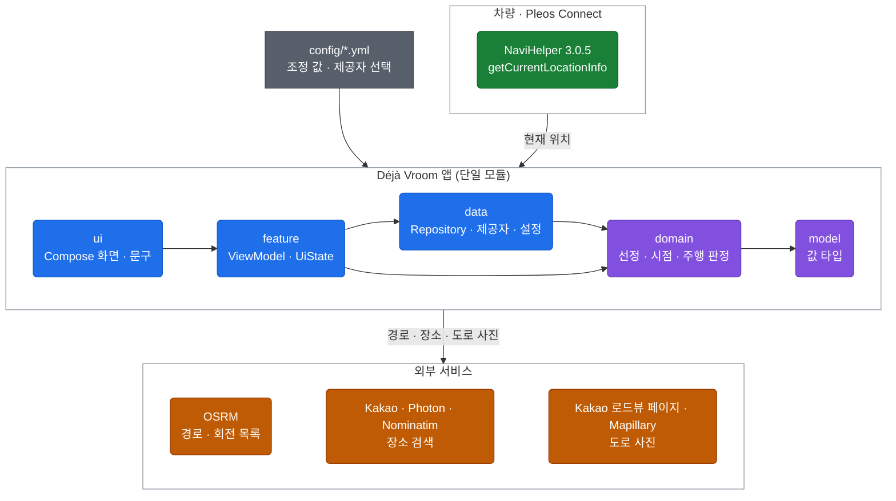
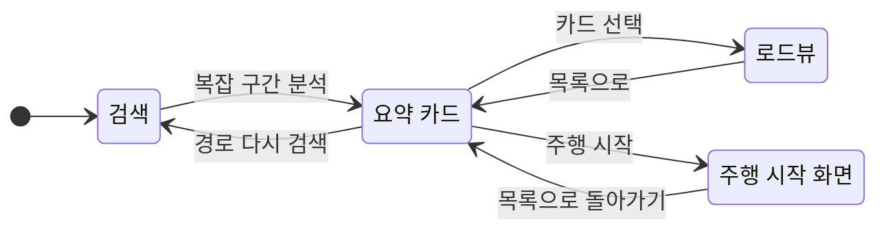
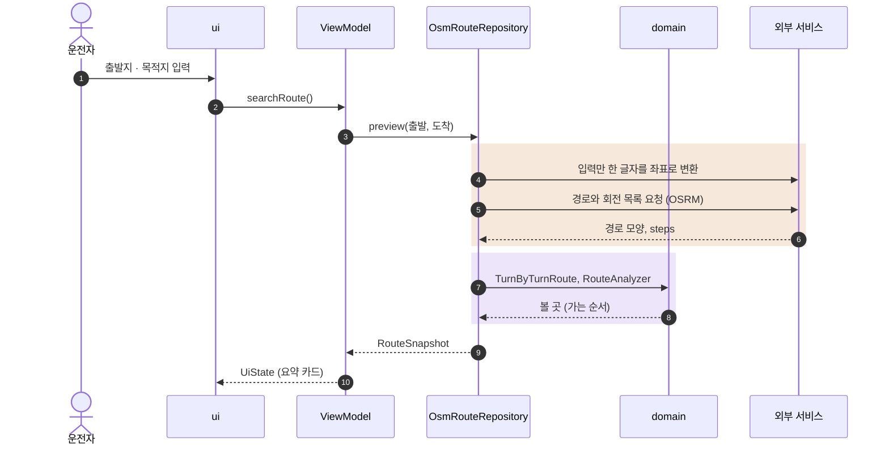
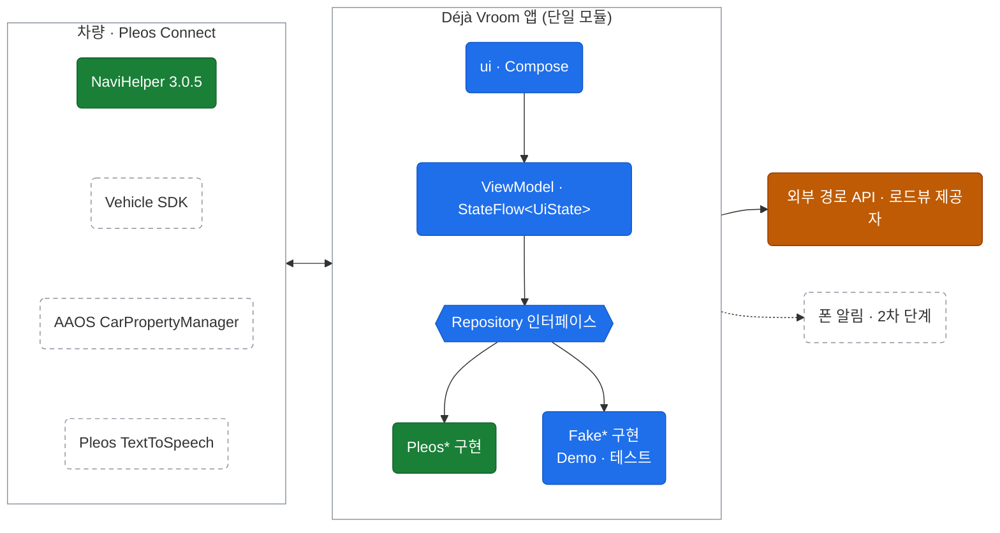
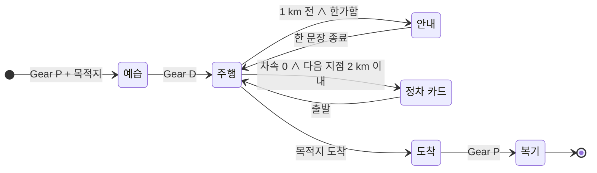

# 구성도

지금 `main`에 구현된 구조와, 2차 단계에서 가려는 목표 구조를 나눠 적는다. 다이어그램의 색은 문서 전체에서 같은 뜻으로 쓴다.

| 색 | 뜻 |
|---|---|
| 파랑 | 앱 코드 |
| 보라 | 순수 Kotlin 도메인 로직 |
| 초록 | 연동한 Pleos SDK |
| 주황 | 외부 서비스 |
| 회색 | 설정 파일 |
| 점선 | 아직 연결하지 않은 계획 |

## 지금 구현

### 계층과 의존 방향

의존은 한 방향이다. 화면은 ViewModel에서 상태를 받는다. Pleos SDK와 외부 서비스 호출은 `data`에 두고, 로드뷰 페이지만 화면의 WebView가 연다.

| 패키지 | 하는 일 | 대표 타입 |
|---|---|---|
| `ui` | Compose 화면과 화면 문구 | `DejaVroomApp`, `SummaryScreen`, `RoadViewScreen`, `Labels.kt` |
| `feature` | ViewModel과 불변 `UiState` | `DejaVroomViewModel`, `DejaVroomUiState` |
| `domain` | 볼 곳 선정, 시점 계산, 지나온 지점 판정. 순수 Kotlin이다 | `TurnByTurnRoute`, `RouteAnalyzer`, `ApproachPolicy`, `Trip` |
| `data` | Repository 인터페이스와 구현, 제공자 선택, 설정 읽기 | `OsmRouteRepository`, `PleosCurrentLocationRepository`, `RoadViewProviderFactory`, `BriefingSettings` |
| `model` | 계층 사이에 주고받는 값 타입 | `RouteSnapshot`, `BriefingSegment`, `Place`, `GeoCoordinate` |
| `core/designsystem` | 테마 | `DejaVroomTheme` |

### 화면 흐름

화면은 네 개이고, 요약 카드가 가운데에 있다.

### 검색 한 번의 흐름

외부 서비스에서 받은 경로는 `domain`을 거쳐야 카드가 된다. 주황 구간은 네트워크, 보라 구간은 순수 계산이다.

### 로드뷰 제공자

도로 사진은 `data/RoadViewProvider.kt`의 인터페이스 하나로 감싼다. 구현체(`KakaoRoadViewProvider`, `MapillaryRoadViewProvider`, `DemoRoadViewProvider`)는 `RoadViewProviderFactory`가 `config/roadview.yml`과 `local.properties`를 보고 고른다. 결과는 `RoadViewContent`(InteractivePage · StillImage · Illustration)로 오고, 화면은 이 타입으로만 분기한다. 자세한 내용은 [README](../README.md#로드뷰-제공자-선택)에 있다.

### 장소 검색 제공자

추천 검색어와 입력한 글자의 장소 변환은 `data/PlaceSearchRepository.kt`의 인터페이스 하나로 감싼다. 구현체(`KakaoPlaceSearchRepository`, `PhotonPlaceSearchRepository`)는 `PlaceSearchFactory`가 `config/search.yml`의 `placeSearch.provider`를 보고 고른다. Kakao 구현체는 로드뷰와 같은 사이트의 검색 페이지를 보이지 않는 WebView로 열어 묻는다. 자세한 내용은 [장소 검색 설정](place-search-setup.md)에 있다.

## 목표 구조

이 절은 2차 단계의 설계다. 차량 신호, 음성, 정차 카드, 복기는 아직 구현하지 않았다.

### 전체 구성

차량 신호는 `Pleos*` 구현만 읽고, 같은 인터페이스의 `Fake*` 구현으로 차 없이 시연한다.

### 앱 계층

| 계층 | 역할 | 규칙 |
|---|---|---|
| `ui` | Compose 화면: P 카드, 정차 카드, 복기 | 상태를 받아 그리기만 한다. SDK를 직접 호출하지 않는다 |
| `ViewModel` | 불변 `UiState`를 `StateFlow`로 노출 | 기어·주행 상태에 따라 표시할 화면을 정한다 |
| 도메인 로직 | 볼 곳 점수, 한가함 판정, 이력·익숙함 | 순수 Kotlin. 단위 테스트로 검증한다 |
| `Repository` | 차량 신호와 내비 정보를 `Flow`로 감싼다 | Pleos SDK는 `data/**/Pleos*` 안에서만 호출한다 |
| `Fake*` | 차량 신호 없이 시연·테스트 | Repository마다 하나씩 둔다 |

### 상태 흐름

기어와 차속이 화면을 정한다. 안내는 주행 중 한가한 순간에만 끼어든다.

## Pleos SDK · API 매핑

| 기능 | API | 상태 |
|---|---|---|
| 출발지(현재 위치), 지나온 지점 판정 | NaviHelper `getCurrentLocationInfo` | **연동**. 빌드와 단위 테스트까지 확인, Pleos 환경 동작은 확인 필요. [사용 현황](pleos-sdk.md) |
| 목적지, 경로 상태 | NaviHelper `requestRoute`, `getDestinationInfo`, `getRouteStateInfo` | 문서 확인 |
| 다음 회전 | NaviHelper `getTBTInfo` / `onTBTInfo` | 문서 확인 |
| 지나침 비율 | NaviHelper 재탐색 이벤트 | **실측 필요** |
| 처음 판정 (이력) | NaviHelper `getCurrentLocationInfo` | 문서 확인 |
| 쉬운 길로 변경 | NaviHelper `changeRouteOption` (편안한 길) | 문서 확인 |
| 한가함·망설임 | Vehicle `TurnSignal`, `SteeringWheel`, `Brake` | 문서 확인, 콜백 주기 **실측 필요** |
| 기어, 차속 | AAOS `GEAR_SELECTION`, 차속 프로퍼티 | 서드파티 권한 **실측 필요** |
| 한 문장 안내 | Pleos TextToSpeech | 사용 가능 여부 확인 필요 |
| 경로 전체 회전 목록 | 외부 경로 API | 키·약관 확인 필요 |
| 사진 | `RoadViewProvider` 구현체: Kakao 로드뷰(GitHub Pages 페이지) 또는 Mapillary Graph API. `config/roadview.yml`로 선택 | 차량 화면 이용 약관 확인 필요 |

## 알려진 한계

- **NaviHelper는 다음 회전 하나만 제공한다.** 출발 전 볼 곳은 같은 목적지로 외부 경로 API의 회전 목록을 받아 고르고, 주행 중 TBT 수신 때마다 다시 판정한다. 두 경로가 어긋날 수 있다.
- **크라우드 데이터는 초기에 없다.** 첫날에는 주행 이력만으로 "처음 가는 갈림길 + 도착 입구 + 복기"가 동작하도록 설계했다. 헤맨 지점과 지나침 비율은 2차 단계다.
- **차량 제어는 쓰지 않는다.** 읽기와 안내만 한다.
- **검증되지 않은 차로 번호나 회전 방향은 안내하지 않는다.** 사진 위치와 경로 일치를 확인하지 못하면 차로 안내를 만들지 않는다.

## 비밀 값과 개인정보

- 토큰과 키는 `local.properties`(git 제외)에 두고 저장소에 올리지 않는다. Kakao JavaScript 키는 앱에 넣지 않고 로드뷰 페이지에만 둔다. Mapillary 토큰은 빌드할 때 APK에 들어가므로 공개 클라이언트 토큰으로 다룬다.
- 위치 이력은 기기 안에 두고, 처음 판정과 복기에 필요한 만큼만 저장한다. 속도와 급제동은 기록하지 않는다.
- 차량의 현재 위치는 저장하지 않는다. 가장 최근 주행 한 건(목적지, 보여 준 지점, 경로 모양)만 기기에 두고, 도착하거나 하루가 지나면 지운다. 경로 모양은 출발지 근처에서 시작하므로 대략의 출발 위치가 함께 남는다. 전송 범위는 [Pleos SDK 사용 현황](pleos-sdk.md#위치-정보를-다루는-범위)에 있다.
