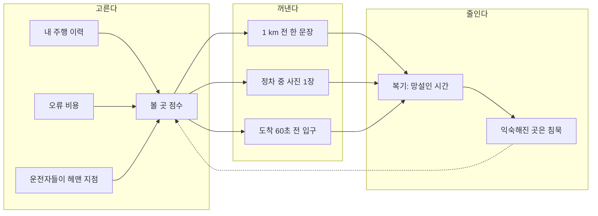

# 서비스 컨셉

Déjà Vroom은 초행길 예습을 "출발 전에 다 보기"에서 "**차가 고른 곳만, 필요한 순간에**"로 바꾸는 차량 앱이에요.

## 문제

| 지금 하는 방법 | 왜 안 통하나 |
|---|---|
| 출발 전에 지도 앱 로드뷰로 경로를 훑어봄 | 회전 20개를 다 보거나, 지쳐서 안 봐요. 보고 가도 가는 길에 잊어요 |
| 내비 음성을 따라감 | 모든 회전을 같은 크기로 말해요. 되돌릴 수 없는 회전과 쉬운 회전이 구분되지 않아요 |
| 도착 후 주차장 입구 찾기 | 내비는 "목적지 부근"에서 끝나요. 입구가 건물 뒤 골목이면 지나쳐요 |

초행길이 무서운 진짜 이유는 어려운 회전이 아니라 **되돌릴 수 없는 회전**이에요.

## 해법: 고르고, 꺼내고, 줄인다



## 볼 곳 고르는 규칙

경로의 지점마다 점수를 매겨요.

```text
점수 = 처음(내 이력)            × 1.0
     + 오류 비용(틀리면 몇 분)  × 1.0
     + 실측 난이도(헤맨 차들)   × 0.8
     + 공공 위험(사고다발 등)   × 0.4
     + 기하 난이도(차로·진출로) × 0.4
     − 익숙함(최근 두 번 무난)  × 1.0
```

| 입력 | 값 | 출처 |
|---|---|---|
| 처음 | 이 지점을 지난 적 0회 = 1.0, 1~2회 = 0.5, 3회 이상 = 0 | 내 차의 위치 이력 |
| 오류 비용 | 잘못 들어갔을 때 목적지까지 더 걸리는 시간. 고속도로 진입·교량·터널이 1.0에 가깝고, 2분 이하면 0 | 재경로 계산 (`requestTrip` 또는 외부 경로 API) |
| 실측 난이도 | 깜빡이 → 차선 변경 p75 시간, 목적지 300 m 안 재탐색 비율 | 차량 크라우드 (2차 단계) |
| 공공 위험 | 사고다발지역, 스쿨존, 급커브 | 공공데이터. **가중치로만** 써요 |
| 기하 난이도 | 좌회전 차로 수, 전용 차로, 진출로 길이, 비보호 여부 | 경로 회전 목록 |
| 익숙함 | 두 번 연속 망설임 없이(깜빡이 → 변경 5초 이내) 지나면 그 지점은 0 | 복기 데이터 |

### 상한: 많이 말하면 안 들어요

| 순간 | 상한 |
|---|---|
| 출발 전 화면 | **2곳**. 점수 1위 + 도착지 입구 |
| 주행 중 음성 | 10분에 1번, 경로 전체 5번 이하 |
| 정차 중 사진 | 다음 지점이 2 km 안일 때만 1장 |
| 아는 길 | 침묵 |

### 하지 않는 것

- **내비가 하는 말은 반복하지 않아요.** 사고다발·스쿨존·단속카메라는 내비 주의 지점에 이미 있어요. 우리는 점수를 올리는 데만 써요.
- **상태가 아니라 행동을 말해요.** 문장에는 동사가 하나 있어야 해요. "사고 많은 곳이에요" ✕ → "지금 2차로로 가 두세요" ○
- **틀렸을 때의 비용으로 크기를 정해요.** "여기 놓치면 고속도로 타서 12분 돌아요."
- **통하지 않은 안내는 버려요.** 말한 뒤에도 망설임이 줄지 않으면 그 지점은 다음부터 말하지 않아요.
- **속도와 급제동은 쓰지 않아요.** 운전 점수가 아니에요.

## 왜 차에서만 되나

| | 폰 지도 앱 | Déjà Vroom |
|---|---|---|
| 어느 곳을 보여 줄지 | 전부 | 내 이력, 깜빡이·조향 타임스탬프, 재탐색 이벤트로 골라요 |
| 언제 보여 줄지 | 출발 전에 끝나요 | 1 km 전, 한가할 때, 멈췄을 때, 서행할 때. 전부 차 신호예요 |
| 다녀온 뒤 | 없음 | "깜빡이 켜고 14초"를 재서 다음 예습의 분량을 정해요 |

로드뷰는 재료일 뿐이에요. 어느 장면을 언제 꺼낼지는 차만 정할 수 있어요.

## 누가 쓰나

| 대상 | 쓰는 이유 |
|---|---|
| 장롱면허·초보 운전자 | 처음 가는 길에 대한 두려움이 숫자로 줄어드는 걸 봐요 |
| 렌터카 이용자, 외국인 여행자 | 모든 길이 초행길이에요 |
| 운전연수 업체, 보험 초보 특약 | 익숙해지는 과정을 기록으로 보여 줄 수 있어요 |
