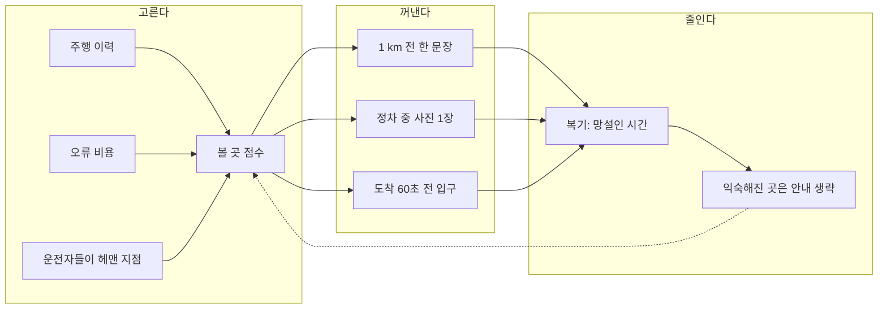

# 서비스 컨셉

Déjà Vroom은 초행길 예습을 "출발 전에 전부 보기"에서 "**차가 고른 곳만, 필요한 순간에**"로 바꾸는 차량 앱이다.

## 문제

| 지금 방법 | 한계 |
|---|---|
| 출발 전에 지도 앱 로드뷰로 경로를 훑는다 | 회전 20개를 다 보거나 아예 보지 않는다. 보고 가도 주행 중에 잊는다 |
| 내비 음성을 따라간다 | 모든 회전을 같은 크기로 안내한다. 되돌릴 수 없는 회전과 쉬운 회전이 구분되지 않는다 |
| 도착 후 주차장 입구를 찾는다 | 내비 안내는 "목적지 부근"에서 끝난다. 입구가 건물 뒤 골목이면 지나친다 |

초행길이 어려운 이유는 회전이 어려워서가 아니라 **되돌릴 수 없는 회전**이 있기 때문이다.

## 해법: 고르고, 꺼내고, 줄인다



## 볼 곳 선정 규칙

경로의 지점마다 점수를 매긴다.

```text
점수 = 처음(주행 이력)          × 1.0
     + 오류 비용(틀리면 몇 분)  × 1.0
     + 실측 난이도(헤맨 차들)   × 0.8
     + 공공 위험(사고다발 등)   × 0.4
     + 기하 난이도(차로·진출로) × 0.4
     − 익숙함(최근 두 번 무난)  × 1.0
```

| 입력 | 값 | 출처 |
|---|---|---|
| 처음 | 이 지점 통과 0회 = 1.0, 1~2회 = 0.5, 3회 이상 = 0 | 차량 위치 이력 |
| 오류 비용 | 잘못 진입했을 때 목적지까지 추가 소요 시간. 고속도로 진입·교량·터널이 1.0에 가깝고, 2분 이하는 0 | 재경로 계산 (`requestTrip` 또는 외부 경로 API) |
| 실측 난이도 | 지시등 → 차선 변경 p75 시간, 목적지 300 m 안 재탐색 비율 | 차량 크라우드 (2차 단계) |
| 공공 위험 | 사고다발지역, 스쿨존, 급커브 | 공공데이터. **가중치로만** 사용 |
| 기하 난이도 | 좌회전 차로 수, 전용 차로, 진출로 길이, 비보호 여부 | 경로 회전 목록 |
| 익숙함 | 두 번 연속 망설임 없이(지시등 → 변경 5초 이내) 통과하면 그 지점은 0 | 복기 데이터 |

### 상한

안내가 많으면 운전자가 듣지 않는다.

| 순간 | 상한 |
|---|---|
| 출발 전 화면 | **2곳**. 점수 1위 + 도착지 입구 |
| 주행 중 음성 | 10분에 1회, 경로 전체 5회 이하 |
| 정차 중 사진 | 다음 지점이 2 km 이내일 때만 1장 |
| 아는 길 | 안내 없음 |

### 하지 않는 것

- **내비 안내를 반복하지 않는다.** 사고다발·스쿨존·단속카메라는 내비 주의 지점에 이미 있다. 점수 계산에만 쓴다.
- **상태가 아니라 행동을 안내한다.** 문장에는 동사가 하나 있어야 한다. "사고 많은 곳" ✕ → "지금 2차로로 이동" ○
- **오류 비용으로 안내의 강도를 정한다.** 예: "놓치면 고속도로로 진입해 12분 우회"
- **효과 없는 안내는 중단한다.** 안내 뒤에도 망설임이 줄지 않은 지점은 다음부터 안내하지 않는다.
- **속도와 급제동은 쓰지 않는다.** 운전 점수가 아니다.

## 차량 앱이어야 하는 이유

| | 폰 지도 앱 | Déjà Vroom |
|---|---|---|
| 보여 줄 곳 | 전부 | 주행 이력, 지시등·조향 타임스탬프, 재탐색 이벤트로 선정 |
| 보여 줄 때 | 출발 전에 끝남 | 1 km 전, 한가할 때, 정차·서행할 때. 모두 차량 신호로 판단 |
| 다녀온 뒤 | 없음 | "지시등 켜고 14초"를 측정해 다음 예습 분량을 정함 |

로드뷰는 재료다. 어느 장면을 언제 꺼낼지는 차량 신호로만 정할 수 있다.

## 대상 사용자

| 대상 | 사용 이유 |
|---|---|
| 장롱면허·초보 운전자 | 초행길 부담이 줄어드는 과정을 수치로 확인 |
| 렌터카 이용자, 외국인 여행자 | 모든 길이 초행길 |
| 운전연수 업체, 보험 초보 특약 | 익숙해지는 과정을 기록으로 제공 |
