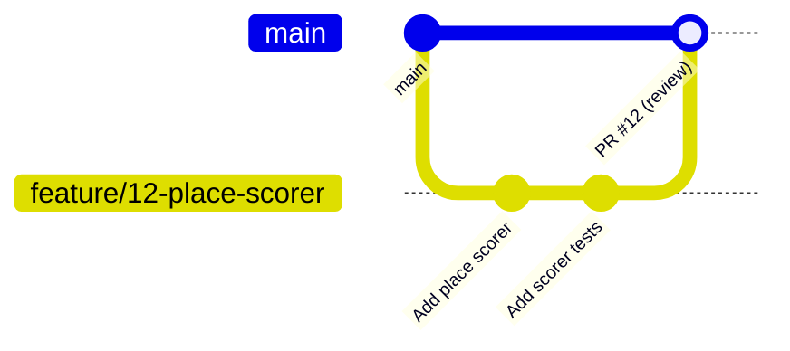

# 코드 컨벤션

원문 규칙은 [`.claude/rules/`](../.claude/rules/)와 [아키텍처 스킬](../.claude/skills/android-app-architecture/SKILL.md)에 있다. 이 문서는 요약본이다.

## 언어

| 대상 | 언어 |
|---|---|
| 코드, 식별자 | 영어 |
| 커밋 메시지, PR 제목·본문, 문서, 스펙(`specs/**`), Discussions | 한국어 |
| 앱 화면 문구 | 한국어 (`strings.xml`, 하드코딩 금지) |

## Kotlin · Compose

| 규칙 | 예 |
|---|---|
| 화면 상태는 불변 `data class UiState` 하나, `StateFlow`로 노출 | `val uiState: StateFlow<BriefingUiState>` |
| Composable은 상태를 받고 이벤트를 올린다 (state hoisting) | `BriefingCard(state, onNext = vm::next)` |
| Pleos SDK는 `data/**/Pleos*Repository` 안에서만 호출 | UI·ViewModel에서 SDK import 금지 |
| SDK 콜백은 한 번만 `suspend` / `callbackFlow`로 감싼다 | `fun turnSignal(): Flow<TurnSignal>` |
| 모든 Repository 인터페이스에 `Fake*` 구현 | `FakeNaviRepository` (Demo·테스트) |
| SDK 호출 전 지원 여부(capability) 확인, 미지원 시 UI 비활성화 | – |
| 주행 중 화면은 `CarUxRestrictions`를 따른다 | 주행 중 키보드·영상 금지 |
| 코루틴은 `viewModelScope` / 주입한 `CoroutineDispatcher` | `GlobalScope` 금지 |
| 도메인 판단은 도메인 타입의 행동으로 둔다 (Rich domain model) | `observation.assess()`, `candidate.scoreWith(weights)` |
| 시연하며 바꿀 값은 규칙 객체로 묶어 주입하고 `config/*.yml`에서 읽는다. 정의에 가까운 값만 상수로 둔다 | `SelectionRules`, `ApproachPolicy` ← `config/briefing.yml`, `SearchSettings` ← `config/search.yml` |

## 포맷 · 린트

Spotless가 ktlint로 Kotlin 파일(`app/src/**/*.kt`, `*.gradle.kts`)을 정리하고 검사한다. 규칙은 [`.editorconfig`](../.editorconfig)에 있다. 공식 Kotlin 스타일, 한 줄 120자, 쓰지 않는 import 삭제다.

| 언제 | 하는 일 | 걸리면 |
|---|---|---|
| 커밋 직전 (`.githooks/pre-commit`) | 커밋에 든 Kotlin 파일을 포맷하고 다시 담는다 | 자동으로 못 고치는 위반(예: 120자를 넘는 줄)이 있으면 커밋이 멈춘다 |
| 푸시 직전 (`.githooks/pre-push`) | `spotlessCheck` | 푸시가 멈춘다 |
| PR (`.github/workflows/android-ci.yml`) | `spotlessCheck`와 단위 테스트 | 검사가 실패로 표시된다 |
| 직접 | `./gradlew spotlessApply`로 고치고 `./gradlew spotlessCheck`로 확인한다 | – |

- 훅은 빌드할 때 연결된다. Gradle 작업 `installGitHooks`가 `core.hooksPath`를 `.githooks`로 맞춘다. 빌드 없이 바로 쓰려면 `git config core.hooksPath .githooks`를 실행한다.
- 기존 코드는 한꺼번에 바꾸지 않는다. `origin/main`과 달라진 파일만 대상이다(`ratchetFrom`). 파일을 처음 고칠 때 그 파일 전체를 규칙에 맞춘다.
- 훅은 Gradle을 실행한다. Kotlin 파일이 든 커밋과 푸시는 그 시간만큼 늦어지고, Kotlin 파일이 없으면 바로 끝난다.

## 패키지

```text
ai.dejavroom.app/
  ui/         Compose 화면, 테마(Pleos 디자인 토큰)
  feature/    화면별 ViewModel + UiState
  domain/     경로 해석과 선정 정책 (순수 Kotlin, Android 의존 없음)
  data/       Repository 인터페이스, 외부 서비스·Pleos* 구현, Fake* 구현, 설정 읽기
  model/      도메인 타입. 값만 담지 않고 자기 판단을 메서드로 가진다
```

## Rich domain model

판단은 그 판단에 필요한 데이터를 가진 타입이 한다. 데이터 클래스에서 값을 꺼내 바깥의 `object`가 계산하는 방식은 쓰지 않는다.

| 무엇을 | 어디에 | 예 |
|---|---|---|
| 한 타입의 데이터만으로 되는 판단 | 그 타입의 프로퍼티·메서드 | `ManeuverObservation.requiresAction`, `GeoCoordinate.distanceMetersTo()`, `RouteSnapshot.mostImportantSegments()` |
| 여러 타입을 엮는 흐름 | `domain/`의 클래스 | `RouteAnalyzer`(선정), `TurnByTurnRoute`(경로 맥락) |
| 조정 가능한 기준 | 검증을 스스로 하는 규칙 객체 | `SelectionRules`, `ManeuverRules`, `ApproachPolicy` |
| 외부 형식 변환, 설정 읽기 | `data/` | `OsrmDrivingRouteClient`, `BriefingSettings` |

- 규칙 객체와 값 객체는 `init`에서 범위를 검사한다. 잘못된 값으로는 만들어지지 않는다.
- `RouteCandidateDetector`, `RouteGeometryMatcher`, 화면이 ViewModel을 통째로 받는 부분은 이전 구조가 남아 있다. 손댈 때 같은 방식으로 옮긴다.

## 브랜치 · 커밋 · PR



| 항목 | 규칙 |
|---|---|
| 브랜치 | `feature/<이슈번호>-<slug>`, `fix/…`, `chore/…`. `main` 직접 커밋 금지(훅으로 차단) |
| 커밋 | 한국어 한 줄 요약 (`한가한 순간 판정 추가`), 본문에 이유 |
| PR | [템플릿](../.github/pull_request_template.md) 작성. 스펙의 성공 기준(SC-*)과 검증 결과 기재 |
| 머지 조건 | `./gradlew :app:testDebugUnitTest` 통과 + 리뷰 1명 + 해당 시 에뮬레이터 확인 |
| 강제 푸시 | 금지 |

## 보안

- 비밀 값(Pleos Client ID/Secret, API 키, 서명 키)은 `secrets.properties` / `.env`에 두고 커밋하지 않는다.
- 위치·VIN·음성은 기능에 필요한 만큼만 쓰고 로그에 남기지 않는다.
- SDK 콜백과 외부 API 응답은 경계에서 검증한다(null, 범위). 실패 시 안전한 쪽(안내 생략)으로 처리한다.

## 문서

- 짧게 쓰고 표와 Mermaid를 우선한다. 규칙: [markdown-docs 스킬](../.claude/skills/markdown-docs/SKILL.md).
- 확인하지 못한 사실은 "확인 필요"로 적는다. 앱 기능을 과장하지 않는다.
