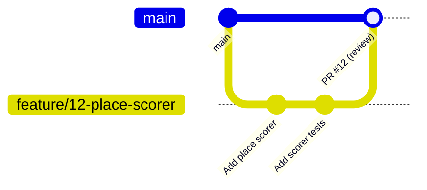

# 코드 컨벤션

원문 규칙은 [`.claude/rules/`](../.claude/rules/)와 [아키텍처 스킬](../.claude/skills/android-app-architecture/SKILL.md)에 있어요. 이 문서는 사람이 읽기 쉽게 요약한 거예요.

## 언어

| 대상 | 언어 |
|---|---|
| 코드, 식별자, 커밋 메시지, PR 제목 | 영어 |
| 문서, 스펙(`specs/**`), PR 본문, Discussions | 한국어 |
| 앱 화면 문구 | 한국어 (`strings.xml`, 하드코딩 금지) |

## Kotlin · Compose

| 규칙 | 예 |
|---|---|
| 화면 상태는 불변 `data class UiState` 하나, `StateFlow`로 노출 | `val uiState: StateFlow<BriefingUiState>` |
| Composable은 상태를 받고 이벤트를 올려요 (state hoisting) | `BriefingCard(state, onNext = vm::next)` |
| Pleos SDK는 `data/**/Pleos*Repository` 안에서만 호출 | UI·ViewModel에서 SDK import 금지 |
| SDK 콜백은 한 번만 `suspend` / `callbackFlow`로 감싸요 | `fun turnSignal(): Flow<TurnSignal>` |
| 모든 Repository 인터페이스에 `Fake*` 구현 | `FakeNaviRepository` (Demo·테스트) |
| SDK 호출 전에 지원 여부(capability) 확인, 안 되면 UI 비활성화 | – |
| 주행 중 화면은 `CarUxRestrictions`를 따라요 | 주행 중 키보드·영상 금지 |
| 코루틴은 `viewModelScope` / 주입한 `CoroutineDispatcher` | `GlobalScope` 금지 |
| 도메인 로직(점수, 한가함 판정)은 순수 함수 + 단위 테스트 | `PlaceScorerTest` |

## 패키지

```text
ai.dejavroom.app/
  ui/         Compose 화면, 테마(Pleos 디자인 토큰)
  feature/    화면별 ViewModel + UiState
  domain/     볼 곳 점수, 한가함 판정 (순수 Kotlin)
  data/       Repository 인터페이스, Pleos* 구현, Fake* 구현
  model/      공용 데이터 모델
```

## 브랜치 · 커밋 · PR



| 항목 | 규칙 |
|---|---|
| 브랜치 | `feature/<이슈번호>-<slug>`, `fix/…`, `chore/…`. `main`에 직접 커밋하지 않아요(훅이 막아요) |
| 커밋 | 영어 명령형 한 줄 요약 (`Add idle-moment detector`), 본문에 왜 |
| PR | [템플릿](../.github/pull_request_template.md)을 채우고, 스펙의 성공 기준(SC-*)과 검증 결과를 적어요 |
| 머지 조건 | `./gradlew :app:testDebugUnitTest` 통과 + 리뷰 1명 + 해당하면 에뮬레이터 확인 |
| 강제 푸시 | 금지 |

## 보안

- 비밀 값(Pleos Client ID/Secret, API 키, 서명 키)은 `secrets.properties` / `.env`에 두고 커밋하지 않아요.
- 위치·VIN·음성은 기능에 꼭 필요한 만큼만 쓰고 로그에 남기지 않아요.
- SDK 콜백과 외부 API 응답은 경계에서 검증해요(null, 범위). 실패하면 안전한 쪽(침묵)으로 가요.

## 문서

- 짧게, 표와 Mermaid 위주로 써요. 규칙: [markdown-docs 스킬](../.claude/skills/markdown-docs/SKILL.md).
- 확인하지 못한 사실은 "확인 필요"로 적어요. 앱 기능을 과장하지 않아요.
