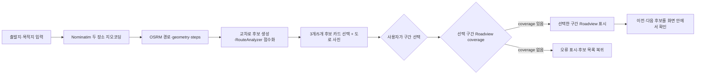

# FirstLook

FirstLook은 출발지와 목적지를 입력하면 실제 도로 경로를 조회하고 복잡한 분기 구간을 점수순 목록으로 보여주며, 사용자가 선택한 구간의 Kakao Roadview를 여는 Android Automotive 프로토타입이다. 출발지와 목적지는 Nominatim으로 각각 검색하며, 경로 geometry와 maneuver 데이터에는 OSRM, 실제 파노라마에는 Kakao Maps Web SDK, 카드용 도로 사진에는 Mapillary 이미지 API를 사용한다. 출발지 초기값은 수원시 영통구이며 편집할 수 있다.

> **현재 흐름은 외부 공개 개발 서비스 기반의 실제 경로 미리보기다.** 실차 위치/경로는 아니며, Pleos NaviHelper·차량 신호와 연결되지 않았다. OSRM이 차로 데이터를 반환한 교차로에서만 경로 유효 차로를 시각화하며, 데이터 누락 때 번호를 추정하지 않는다. 이 표시는 실차 차로 안내나 위험도 판단으로 검증되지 않았다. 서비스 정책·가용성 및 차량용 Roadview 사용 허가도 별도 확인 대상이다.

## 실행 방법

Android Studio에서 프로젝트를 열고 Gradle Sync 후 Pleos Connect Emulator(API 34) 또는 API 28 이상 Android 에뮬레이터에서 `app` 구성을 실행한다.

```bash
./gradlew :app:assembleDebug
./gradlew :app:testDebugUnitTest
```

기본 경로 분석은 네트워크가 필요하다. Kakao JS 키가 설정된 개발 환경에서는 실제 Roadview를 연다. Pleos SDK 승인·실차 런타임 연결은 검증되지 않았다.

### Kakao Roadview 로컬 개발 테스트 (debug 전용)

`local.properties`에 `kakaoJsKey=<Kakao JavaScript 키>`와 `mapillaryAccessToken=<Mapillary 앱 토큰>`을 입력하고 Kakao Developers의 JavaScript SDK 허용 도메인에 `http://localhost:8080`이 등록되어 있는지 확인한다. 값은 Git이나 Android APK에 포함하지 않는다. Kakao JavaScript 키는 웹 클라이언트 키로 도메인 제한을 유지하고, Mapillary 토큰은 개발 서버가 이미지 검색에 사용한다.

```bash
scripts/roadview/serve.sh
```

연결된 Android 에뮬레이터가 있으면 스크립트가 `adb reverse tcp:8080 tcp:8080`을 설정한다. 먼저 이 서버를 실행한 뒤 앱에서 출발지와 목적지를 입력하고 `복잡 구간 분석`을 누른다. 점수순 후보 카드가 나오면 원하는 후보를 선택해 Roadview를 연다. Roadview 하단의 이전/다음 버튼으로 목록 복귀 없이 후보를 연속 확인할 수 있다. 별도 렌더 확인은 브라우저에서 `http://localhost:8080/roadview/`를 연다. 상단의 `Kakao Roadview 개발 테스트`는 route가 없는 고정 OSM fixture 확인용으로 남겨 두었다. `adb`가 PATH에 없어도 스크립트가 SDK 경로를 찾는다. 8080 포트가 이미 사용 중이면 기존 서비스를 건드리지 않고 종료한다. 종료할 때 `Ctrl+C`를 누르면 포트 역방향 연결도 정리된다.

기본 route 흐름은 점수순 후보 중 3개/5개 보기를 선택해 보여준다. 각 카드에는 후보 반경 80m의 Mapillary contributor 사진을 정적 이미지로 표시한다. 토큰·사진 coverage·제공처 연결이 없으면 카드 안에 사유를 표시한다. Mapillary 사진에는 기여자 출처 링크를 표시한다. 카드를 고르면 해당 지점의 Roadview를 별도 화면으로 연다. 차량용 표시 허가와 Pleos 실제 기기/운전 제한 연동은 별도 미검증이다.

카드 사진 공급자로 Google Street View Static API는 채택하지 않았다. Google 약관은 Google Street View 이미지와 비Google 지도 콘텐츠를 같은 화면에 표시하지 못하게 제한하므로 Kakao Roadview를 사용하는 이 구성과 맞지 않는다. [Google Maps Platform Terms](https://cloud.google.com/maps-platform/terms)

Kakao SDK는 초기화 과정에서 HTTP 주소의 SDK 보조 파일도 요청한다. 개발 페이지의 CSP는 이를 HTTPS로 승격하고, 로드뷰 조회에 필요한 `rv.map.kakao.com`만 추가 허용한다. Android cleartext 네트워크 정책은 localhost 외부에 계속 금지되어 있다. 이 로컬 개발 설정을 release나 임의 호스트로 확장하지 않는다.

Kakao 공개 API는 기본 이동 화살표 크기·방향별 표시 옵션을 제공하지 않는다. 개발 WebView에서 `_ar_N_*` 화살표와 `_at_N_*` 방위 표기를 짝지어 route heading과 같은 8방위 하나만 보이고 CSS `scale: .65`로 표시한다. 비공식 Kakao 내부 DOM 구조에 의존하며 SDK 변경 시 깨질 수 있다. 이 도로 위 화살표는 진행 방향을 나타내며 차로 지시나 노면 경로선은 아니다. 오른쪽 상단 패널에는 선택 구간명·분석 점수·근거가 표시되고, 차로 데이터가 있을 때만 유효 차로를 그린다.

Kakao Roadview의 좌표 `CustomOverlay`로 OSRM geometry를 파란 점선으로 바꾸는 시제품도 시험했지만, 실제 panorama에서 도로 표면에 정합되지 않고 차 위로 떠 보여 기본 흐름에는 넣지 않았다. Kakao 공개 Web API는 연속 경로선을 panorama 도로 면에 자동 정합하는 기능을 제공하지 않는다. 현재는 후보명·점수·출처 근거를 레이블로 보여주며, 노면 강조선은 사진-경로 정합이 확보된 뒤 적용한다. 실험 근거는 [Roadview 상태 기록](kakao-roadview-implementation-status.md)에 있다.

검수된 OSM way에서 `at`/방위/주의·진행 점을 계산하는 개발용 authoring 도구는 [교차로 레코드 작성 가이드](route-record-authoring.md)에 있다. 생성 JSON은 route ID, OSM way 출처와 ODbL attribution을 보존한다. 개발 시연용 OSM fixture 1건은 `fixtures/hannam-daero/`에 있다. Kakao JS 키는 ignored `local.properties`에 로컬 설정하며 Git에 포함하지 않는다. Pleos 차량 신호/NaviHelper 소스는 연결되지 않았다.

경로 후보 점수화, 후보 카드 → 선택 Roadview 흐름, emulator 실행 증거 및 남은 외부 의존성은 [구현 상태 보고서](kakao-roadview-implementation-status.md)에 기록했다. 실제 경로 기반 화면은 debug WebView에서 확인했다. 별도의 OSM fixture overlay demo도 유지한다. live navigation 및 Pleos 차량 권한은 별도 미검증이다.

## Demo 시나리오

1. 출발지(예: 서울역)와 목적지(예: 강남역)를 입력한다. 둘 다 장소명/주소로 편집할 수 있으며, 제출하면 각각 지오코딩한다. 현재 위치 자동 감지는 연결되지 않았다.
2. `복잡 구간 분석`을 누르면 Nominatim이 두 장소를 지오코딩하고 OSRM이 driving route/steps/geometry를 반환한다.
3. `RouteAnalyzer`가 분기 수와 maneuver 근거로 복잡 후보 최대 5곳을 점수화하고, 화면에서 3개/5개 보기를 선택해 후보 카드를 확인한다. 실제 사진 표시에는 Mapillary 토큰과 해당 구간 contributor 이미지 coverage가 필요하다.
4. 카드에서 확인할 구간을 직접 선택하면 그 구간만 Kakao panorama coverage를 조회해 Roadview를 연다. 하단의 이전/다음 버튼을 누르면 목록에 돌아오지 않고 이 화면에서 후보가 전환된다. 마지막 후보에서는 후보 목록으로 돌아간다.
5. 선택한 후보에 panorama가 없거나 외부 서비스 요청이 실패하면 이유를 표시하고 후보 목록으로 돌아갈 수 있다. 이 흐름은 실차 내비가 아닌 개발용 경로 미리보기다.

## 화면 흐름



## 아키텍처

`feature`의 `FirstLookViewModel`은 기본 route repository로 `OsmRouteRepository`를 호출한다. 이 repository는 편집한 출발지와 목적지를 Nominatim으로 각각 지오코딩하고 OSRM 경로 응답을 검증된 geometry와 topology feature로 변환해 `RouteAnalyzer`에 전달한다. `RouteCandidateDetector`와 `RouteGeometryMatcher`가 후보를 같은 route geometry에 매칭하고 점수화한다. OSRM의 `intersection.lanes`가 제공되면 route-valid 차로 정보를 선택 후보에 전달한다. debug WebView bridge는 사용자가 고른 후보만 Kakao coverage를 조회해 연다. 후보 카드 사진은 개발 서버가 Mapillary API에서 가져온다. 별도 `JunctionRecordMatcher`/OSM authored record fixture는 교차로 표식 알고리즘의 독립 검증 흐름이다. Kakao WebView는 debug 전용이며 release에는 연결되지 않는다. public routing/geocoding, debug-only Kakao 키, Fake `DrivingRestrictionSource`, Mock `PleosNavigationGateway`가 현재 범위다. 주소 입력은 되지만 GPS/NaviHelper 기반 자동 출발지는 아직 연결되지 않았다.

```text
app/src/main/kotlin/ai/firstlook/app/
  model/       경로 출처·geometry 상태, 구간 선택 근거, OSM 교차로 레코드, RoadView 매칭 상태
  data/        route/junction matcher, RoadView eligibility, repositories and provider contracts
  feature/     ViewModel + StateFlow UI state
  MainActivity.kt  Compose 화면 및 공통 데모 이미지 구성

app/src/main/res/drawable-nodpi/
  demo_*.png  가상의 AI 생성 장면 (실제 도로 사진 아님)
```

현재 크기에서는 단일 Activity·단일 모듈로 구성했다. Hilt나 별도 domain 계층은 추가하지 않았다. Pleos SDK는 feature/UI 코드에서 호출하지 않는다.

## 연동 상태

| 기능 | 구현 상태 | 실제 API / Mock | 비고 |
|---|---|---|---|
| 목적지 설정 | 완료 | 사용자 입력 | 목적지 직접 제출 및 최근 검색 선택 |
| 목적지 지오코딩 | 구현 | Nominatim | 제출 후 1회 조회, autocomplete 없음, 개발용 저빈도 정책 적용 |
| 경로 탐색 | 개발 프로토타입 | OSRM public demo | 입력한 출발지·목적지, distance/duration/full GeoJSON/steps; GPS 자동 출발지는 미연결 |
| 주요 구간 추출 | 개발 프로토타입 | OSRM steps + OSM graph | 분기 수·fork/merge/ramp/roundabout 기반 후보, RouteAnalyzer 점수화 |
| 경로 후보 검증·점수화 | 구현 | OSRM route geometry + OSM graph | route ID·geometry 매칭, 분기/maneuver 복잡도 근거와 점수 순 후보 |
| OSM 교차로 레코드 생성 | 개발용 도구 | OpenStreetMap fixture | 사람이 approach/keep/trap 선택; at·pan·caution·20/40/60m 생성; ODbL attribution 포함 |
| 수동 검수 교차로 route 매칭 | 구현 | Kotlin synthetic fixtures | exact route ID·geometry 검증, Roadview 미지원이면 diagram candidate 유지; live source 미연동 |
| 구간 후보 점수화 | 개발 프로토타입 | OSRM/OSM route observations | public route 응답에서 후보 생성; 일부 응답의 lane 정보를 전달하지만 차량 route/실차 안내는 아님 |
| 로드뷰 상태/시점 | 보조 legacy UI | Demo provider | 다중 view paging UI; 기본 목적지 제출 흐름에서는 사용하지 않음 |
| 후보 카드 도로 사진 | 개발 프로토타입 | Mapillary Graph API | 3개/5개 보기; 토큰·coverage가 없으면 카드 안에 안내 표시; 사진 출처 표기 |
| Kakao Roadview 선택 화면 | 개발용 구현 | Kakao Web SDK live panorama | 사용자가 고른 단일 후보의 사진 및 경로 heading 표시 |
| 기본 이동 화살표 크기·방향 | 비공식 개발 적용 | WebView DOM `_ar_N_*`/`_at_N_*` 필터 및 scale 0.65 | heading의 8방위 한 쌍만 표시; Kakao 비공개 DOM selector 의존 |
| OSRM 차로 패널 | 개발 프로토타입 | OSRM `intersection.lanes` | `valid=true` 차로를 강조; field 미제공 시 진행 방향과 정보 없음 문구 |
| 교차로 주의·진행 overlay | 개발 시연 검증 | Kakao CustomOverlay | OSM authored record fixture의 caution 1개 + 갈래 표식 6개; 기본 live route 흐름과 별도 |
| 음성 브리핑 | lifecycle 연결 | No-op | 구간 전환/토글/이탈 때 중지 요청; Pleos TTS 및 가청 출력 미연동 |
| 주행 제한 UI | Fake 상태 구현 | Mock | 제한 모드 시연 UI; CarUxRestrictions 실제 신호 미연동 |
| 내비게이션 연동 | Mock 화면 | Mock | NaviHelper 목적지·화면 요청 미연동 |
| 현재 위치 조회 | 미구현 | 없음 | NaviHelper 조회 또는 Pleos FusedLocation 미연동 |
| 차량 상태 조회 | 미구현 | 없음 | Vehicle SDK 미연동 |
| 사고 다발 구간 | 미구현 | 없음 | 공공데이터 연동 없음 |

## Pleos 및 지도 API 조사

공식 Pleos NaviHelper 문서는 v3.0.5에서 목적지 설정, 경로 탐색/주행 이벤트, 내비 정보 조회 및 Navigation 화면 요청을 안내한다. 2026-11-11 임시 Gradle probe에서 공개 Maven의 NaviHelper 3.0.5 및 TTS 3.3.1 AAR과 전이 의존성 resolve를 확인했다. 이는 artifact 다운로드 가능성만 확인한 결과다. 현재 앱에는 SDK dependency/import가 없으며 Pleos My Project 권한과 차량 runtime도 확인되지 않았다. [NaviHelper 공식 문서](https://document.pleos.ai/en/docs/pleos-only/connect-sdk-pleos/NaviHelper/intro)

팀의 SDK 조사 자료는 전체 경로 polyline 접근을 보장하지 않는다고 기록한다. NaviHelper의 route summary/POI 포인트를 연속 도로 geometry로 간주하지 않는다. 공식 Playground SDK access 표와 TTS/FusedLocation API 문서의 호환 상태가 일치하지 않아 대상 project status 확인 전에는 No-op/Fake를 유지한다. Vehicle과 FusedLocation도 앱에서 사용하지 않는다. 최신 근거는 [실연동 조사 기록](../../specs/003-firstlook-live-integration/research.md), 자세한 SDK 경계는 [Pleos SDK 기능 요약](../contest/12-pleos-sdk-capabilities.md)을 참조한다.

Kakao Roadview 공식 Web SDK로 개발용 WebView에서 panorama 검색·시점 설정과 OSM overlay를 확인했다. Android RoadView 안내는 별도 협의를 요구한다. 공개 Web API 시연은 차량용 Android 앱의 표시권이나 공모전 배포 권한을 부여하지 않는다. 차량/제출 사용 전에 해당 권리와 키 제한을 확인해야 한다. [Kakao Maps Web API](https://apis.map.kakao.com/web/documentation/) · [Kakao Android RoadView 사용 안내](https://apis.map.kakao.com/android_v2/docs/api-guide/roadview/) · [Naver Panorama API](https://navermaps.github.io/maps.js.ncp/docs/naver.maps.Panorama.html)

공공데이터포털에서 확인한 성수동 360도 이미지 자료는 공간 범위가 제한되어 영통-강남 시연 경로를 제공하지 않는다. 사고 다발 지역 정보는 과거 통계로만 활용할 수 있고 현재 위험 판단으로 쓰지 않는다. 각 후보 조사 결과와 미확인 권리는 [기술·데이터 조사 기록](../../specs/001-firstlook-real-road-briefing/research.md)에 정리했다.

## API 키와 실제 API 전환

Kakao JS 키는 ignored `local.properties`의 `kakaoJsKey`에서 로컬 개발 서버로 읽힌다. 키를 코드/Git에 넣지 않는다. 배포 때는 키 노출 가능성, 도메인/앱 제한 및 서비스 사용 권한을 검토한다.

`RoadViewProvider`는 legacy 브리핑 화면에서 좌표·반경 검색 결과, 촬영일·출처·heading·매칭 상태 및 실패 상태를 표현한다. 기본 목적지 제출 흐름은 분석된 route candidates를 debug Kakao WebView에 보내 coverage가 있는 Roadview로 직접 이동한다. 현재 흐름은 public OSRM/OSM geometry에 한정되며 lane guidance 또는 안전한 주행 판단은 하지 않는다.

legacy 브리핑 화면은 Demo provider의 다중 시점/오류 상태를 렌더링할 수 있고, 여러 view가 들어오면 좌우 버튼으로 인덱스를 이동한다. 기본 목적지 분석 흐름에서는 사용하지 않는다. 제한 모드 데모 버튼은 목적지 입력과 사진 탐색을 잠시 막지만, 이는 `CarUxRestrictions` 또는 차량 신호가 아니다. 음성 UI는 상태 요청만 제공하고 기본 출력이 No-op이므로 소리가 나지 않는다.

## 기술 제약 및 다음 작업

- Pleos SDK 공식 문서는 기능 계약을 확인하는 근거이며, 프로젝트 접근 권한과 실제 차량 런타임 동작은 별도로 확인해야 한다.
- Kakao/Naver/Google 로드뷰 계약과 차량용 WebView/앱 표시 허용 범위를 아직 검증하지 않았다. 저작권이 불명확한 거리뷰 이미지를 다운로드하거나 화면에 임의 삽입하지 않는다.
- 현재 live API는 개발용 public Nominatim/OSRM뿐이다. production routing/geocoding provider, 차량 현재 위치·실제 route 제공, 실차 승인 Kakao Roadview, 공공 사고 데이터, 가청 TTS, Pleos NaviHelper·Vehicle·FusedLocation 및 실제 `CarUxRestrictions` source는 미구현이다. 복잡 구간은 OSM routing graph의 교차로 분기와 maneuver를 기준으로 고르며, 차로 안내나 위험 분석을 하지 않는다.
- 기본 목적지 흐름은 경로 후보 분석 후 Roadview로 직접 진입한다. 실차 주행 상태에서의 입력 제한과 Pleos 정책 검토가 필요하다.
- 목적지 입력의 키보드·회전·다양한 화면 크기 대응은 Pleos Emulator에서 추가 확인해야 한다.

다음 통합 순서는 Pleos 프로젝트 SDK 접근 확인 → NaviHelper repository 연결 및 callback 검증 → 전체 경로 좌표 제공 여부 확인 → 승인된 도로 이미지 공급자 계약 확인 → 경로 매칭/차로 검증 → TTS 및 UX 정책 검토다.
