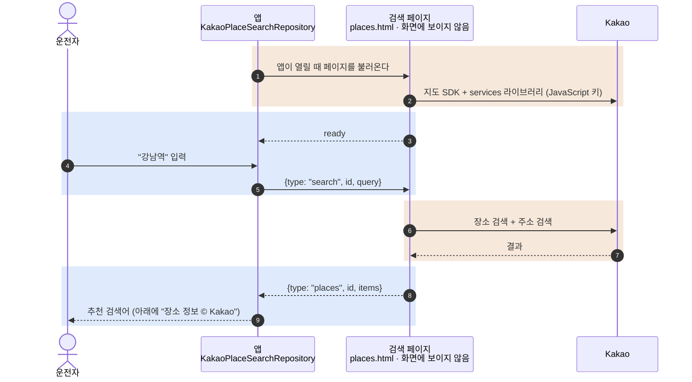

# 장소 검색 설정

출발지·목적지 칸의 추천 검색어와, 입력한 글자를 장소로 바꾸는 일을 어느 서비스가 맡을지 `config/search.yml`의 `placeSearch.provider`로 고른다. 앱 코드는 인터페이스(`PlaceSearchRepository`)만 알고, 구현체는 설정에 따라 바뀐다.

**Kakao 장소 검색에 따로 넣을 키는 없다.** 로드뷰에 쓰는 Kakao JavaScript 키와 페이지 주소를 그대로 쓴다. Kakao 로드뷰가 뜨는 환경이면 장소 검색도 된다.

| `provider` | 데이터 | 필요한 설정 |
|---|---|---|
| `kakao` (기본) | Kakao 장소·주소 검색. 국내 상호, 새 건물, 주소가 최신이다 | 로드뷰와 같다. [넣어야 하는 값](#넣어야-하는-값) |
| `photon` | Photon(추천 검색어)과 Nominatim(입력한 글자). OpenStreetMap 데이터라 국내 상호와 새 건물이 적다 | 없음 |

저장소에는 키와 주소가 들어 있지 않다. 비어 있으면 앱은 다른 서비스로 몰래 바꾸지 않고, 검색 칸 아래에 "Kakao 장소 검색 주소가 설정되지 않았습니다 · docs/place-search-setup.md 참고"를 보여 준다.

## 넣어야 하는 값

로드뷰를 이미 설정했다면 새로 넣을 값은 없다. 처음이라면 [로드뷰 설정](roadview-setup.md)의 1~4단계가 곧 이 설정이다.

| 값 | 넣는 곳 | 저장소에 커밋 |
|---|---|---|
| Kakao **JavaScript 키** (REST API 키가 아니다) | 로컬 서버: `local.properties`의 `kakaoJsKey` · GitHub Pages: 저장소 Secret `KAKAO_JS_KEY` | 하지 않는다 |
| 페이지 주소 | `local.properties`의 `roadviewBaseUrl` (또는 `config/roadview.yml`의 `kakao.baseUrl`) | `local.properties`는 하지 않는다 |
| Web 도메인 등록 | Kakao Developers → 앱 설정 → 플랫폼 → Web. 페이지를 여는 도메인(`http://localhost:8080`, Pages 도메인) | – |

```properties
# local.properties (git 제외). 로컬 서버로 띄울 때의 예
kakaoJsKey=<JavaScript 키>
roadviewBaseUrl=http://localhost:8080/roadview/
```

키는 앱(APK)에 들어가지 않는다. 검색 페이지 안에만 있고, 등록한 도메인에서만 동작한다.

## 동작 방식

앱과 검색 페이지는 메시지로 주고받는다. 주황 구간은 네트워크(검색 페이지와 Kakao를 불러오고 묻는 일)이고, 파랑 구간은 앱과 페이지 사이의 메시지다.



| 파일 | 역할 |
|---|---|
| `web/roadview/places.html`, `places.js` | 검색 페이지. 로드뷰 페이지와 같은 자리에 올라간다 |
| `data/KakaoPlaceSearchRepository.kt` | 페이지를 보이지 않는 WebView로 열고 질문과 답을 주고받는다 |
| `data/KakaoPlacesMessage.kt` | 페이지가 보낸 답을 검사해 장소로 바꾼다. 이름이나 좌표가 없는 결과는 버린다 |
| `data/PlaceSearchFactory.kt` | `provider` 값으로 구현체를 고른다 |

입력한 글자를 고르지 않고 바로 "복잡 구간 분석"을 누르면, 같은 검색의 첫 결과를 그 장소로 쓴다. 주소나 행정구역("수원시 영통구")은 주소 검색 결과가 먼저 온다.

## 설정 순서

1. [로드뷰 설정](roadview-setup.md) 1~4단계를 마친다. 이미 로드뷰가 뜨면 건너뛴다.
2. `config/search.yml`의 `placeSearch.provider`가 `kakao`인지 본다. 기본값이다.
3. 로컬 서버를 쓰면 서버를 다시 띄운다. `places.html`은 이 변경에서 새로 생긴 페이지다.

   ```bash
   scripts/roadview/serve.sh
   ```

4. 앱을 다시 빌드해 설치한다.

GitHub Pages를 쓰면 `main`에 합쳐질 때 배포 작업이 `places.html`에도 키를 넣는다. 저장소 Secret `KAKAO_JS_KEY`가 없으면 배포 작업이 실패하고 페이지가 올라가지 않는다.

## 확인

| 확인 | 기대 |
|---|---|
| 목적지 칸에 두 글자 이상 입력 | 추천 검색어가 뜨고 목록 아래에 "장소 정보 © Kakao"가 보인다 |
| "수원시 영통구" 입력 | 첫 줄에 "경기 수원시 영통구"가 온다 |
| 입력만 하고 "복잡 구간 분석" | 첫 결과의 장소로 경로를 찾는다 |
| logcat `DejaVroomPlaces` | 준비에 실패했을 때만 사유가 남는다 |

## Photon으로 바꾸기

```yaml
# config/search.yml
placeSearch:
  provider: photon
```

키와 페이지 주소 없이 동작한다. 목록 아래 표기가 "© OpenStreetMap contributors (Photon)"으로 바뀐다. 값을 바꾼 뒤에는 앱을 다시 빌드한다.

## 문제 해결

| 검색 칸 아래 문구 | 원인 | 할 일 |
|---|---|---|
| Kakao 장소 검색 주소가 설정되지 않았습니다 | 페이지 주소가 비어 있다 | `local.properties`에 `roadviewBaseUrl`을 넣고 다시 빌드한다 |
| Kakao 장소 검색 페이지에 연결할 수 없습니다 | 로컬 서버가 꺼져 있거나 주소가 틀렸다. 또는 서버가 옛 버전이라 `places.html`이 없다 | 최신 `main`을 받고 `scripts/roadview/serve.sh`를 다시 띄운다. 에뮬레이터는 `adb reverse`가 걸려 있어야 한다(스크립트가 건다) |
| Kakao 장소 검색 페이지가 응답하지 않습니다 | 페이지는 열렸지만 10초 안에 준비되지 않았다 | 네트워크를 확인하고 다시 입력한다 |
| Kakao JavaScript 키가 페이지에 없습니다 | `kakaoJsKey`(또는 Secret)가 비어 있다 | 키를 넣고 서버를 다시 띄운다 |
| Kakao 장소 검색을 불러오지 못했습니다 | 도메인이 등록되지 않았거나, 키가 JavaScript 키가 아니거나, 네트워크가 막혔다 | Kakao Developers의 Web 도메인과 키 종류를 확인한다 |
| Kakao 장소 검색이 오류를 돌려주었습니다 | Kakao 쪽 오류 또는 사용량 한도 | 잠시 뒤 다시 시도한다. 계속되면 Kakao Developers에서 앱의 지도·로컬 사용 설정과 쿼터를 확인한다 |

## 확인하지 못한 것

| 항목 | 상태 |
|---|---|
| 실제 Kakao 응답 | 이 변경은 가짜 SDK로 돌린 시뮬레이션(`node scripts/roadview/simulate-places.js`)과 단위 테스트로만 확인했다. 실제 키로는 확인하지 못했다 |
| 보이지 않는 WebView에서의 동작 | 에뮬레이터에서 확인이 필요하다 |
| Kakao 로컬 검색 결과의 이용 조건 | 검색 결과를 Kakao 지도 없이 목록으로 보여 주는 것이 정책에 맞는지 확인이 필요하다 |

## 보안 메모

- 키는 저장소와 APK에 넣지 않는다. `local.properties`와 저장소 Secret에만 둔다.
- 앱은 검색 페이지의 출처(origin)가 설정한 주소와 같을 때만 그 페이지의 답을 받는다.
- Kakao 장소 검색에는 차량의 현재 위치를 보내지 않는다. 입력한 글자만 보낸다.
