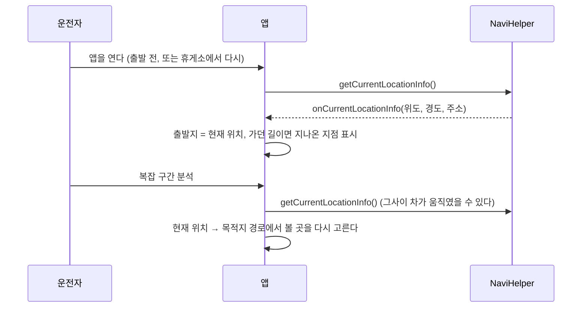

# Pleos SDK 사용 현황

앱이 실제로 호출하는 Pleos SDK와 확인한 범위를 적는다. 앞으로 붙일 API의 계획은 [구성도](architecture.md#pleos-sdk--api-매핑)에 있다.

## 지금 호출하는 것

| SDK | API | 쓰는 곳 | 권한 |
|---|---|---|---|
| NaviHelper 3.0.5 | `initialize(onConnected, onFailed)` → `addListener` → `getCurrentLocationInfo()` → `onCurrentLocationInfo` | 출발지를 차량의 현재 위치로 채운다. 가던 길에 앱을 다시 열면 지나온 지점을 가린다 | `pleos.car.permission.NAVI_ROUTE` |

호출 코드는 `data/PleosCurrentLocationRepository.kt` 한 곳에 있다. 화면과 ViewModel은 `CurrentLocationRepository` 인터페이스만 쓴다.

## 확인한 범위

| 단계 | 상태 | 근거 (2026-11-15) |
|---|---|---|
| 의존성 | 확인 | `ai.pleos.playground:NaviHelper:3.0.5`를 Pleos Nexus 저장소에서 받아 debug·release를 빌드했다 |
| API 시그니처 | 확인 | 배포된 AAR의 클래스에서 메서드와 필드를 확인했다 |
| 응답 검증 | 확인 | 범위를 벗어난 좌표와 (0, 0)을 거부하는 단위 테스트가 있다 |
| Pleos 에뮬레이터·차량에서의 동작 | **미확인** | 서비스 연결, 권한, 응답 시간은 Pleos 환경에서 따로 확인해야 한다 |

NaviHelper는 Pleos Playground에서 신청 없이 쓸 수 있는 SDK로 안내되어 있다(2026-10-24 콘솔 표시 기준). 차량에 내장 내비가 있어야 동작한다.

## 현재 위치를 쓰는 순간

| 순간 | 앱 동작 |
|---|---|
| 앱이 화면에 나올 때마다 | 위치를 읽어 출발지 칸에 "현재 위치"를 넣는다. 운전자가 출발지를 직접 고른 뒤에는 바꾸지 않는다 |
| "◎ 현재 위치" 버튼 | 위치를 읽어 출발지로 쓴다. 읽지 못하면 이유를 출발지 칸 아래에 보여 준다 |
| 경로를 찾기 직전 | 출발지가 현재 위치이면 한 번 더 읽는다 |
| 카드 화면의 "현재 위치에서 다시 찾기" | 위치를 읽고, 거기서 목적지까지 볼 곳을 다시 고른다 |

## 위치를 받지 못할 때

앱은 멈추지 않는다. 출발지를 직접 입력하는 기존 흐름이 그대로 남는다.

| 경우 | 앱 동작 |
|---|---|
| 내비 서비스에 5초 안에 연결되지 않는다 (Pleos가 아닌 기기 포함) | 출발지를 바꾸지 않는다. 버튼을 누른 경우에만 이유를 보여 준다 |
| 연결됐지만 3초 안에 답이 없다 | 위와 같다. 다음 요청에서 다시 연결한다 |
| 좌표가 범위를 벗어나거나 (0, 0)이다 | 위치가 없는 것으로 본다 |
| 위치가 대한민국 밖이다 | 출발지로 쓰지 않는다. 장소 검색과 경로가 대한민국만 다룬다 |

## 지나온 지점 표시

기준은 **가장 최근 주행 한 건**이다. 주행 이력 목록은 만들지 않는다. 운전자가 지금 가는 길은 하나이고, 이력을 쌓으면 저장할 위치 정보만 늘어난다.

| 항목 | 내용 |
|---|---|
| 주행 한 건 | 목적지 하나와, 그 목적지로 가며 화면에 보여 준 지점들 |
| 지나옴 판정 | 현재 위치를 경로 위에 놓고, 그보다 30 m 넘게 뒤에 있는 지점을 지나온 것으로 본다 |
| 경로 옆 | 경로에서 300 m 안이면 경로 위로 본다. 휴게소와 주유소가 여기에 든다 |
| 경로 밖 | 300 m보다 멀면 판정하지 않는다. 표시는 그대로 둔다 |
| 다시 찾기 | 같은 목적지로 현재 위치에서 다시 찾으면 주행이 이어진다. 지나온 지점은 남고, 남은 길의 볼 곳은 새로 고른다 |
| 새 주행 | 목적지를 바꾸거나 출발지를 직접 입력해 찾으면 새 주행으로 본다 |
| 끝 | 목적지 150 m 안에 들어오거나 시작한 지 24시간이 지나면 지운다 |

화면에는 카드 위에 "지나온 곳 2 · 중부대로 갈림길 · 영덕교 갈림길" 한 줄이 생긴다. 화면에 있는 카드가 지나온 지점이면 흐리게 하고 "지나옴"을 붙이며, 다음에 만날 카드에 "다음"을 붙인다.

## 위치 정보를 다루는 범위

| 항목 | 내용 |
|---|---|
| 기기에 저장 | 주행 한 건: 목적지 이름과 좌표, 보여 준 지점의 이름과 좌표, 경로 모양(최대 2,000점), 경로 위 진행 거리. `SharedPreferences`에 두고 서버로 보내지 않는다 |
| 저장하지 않음 | 현재 위치 자체. 진행 거리를 계산하는 데만 쓴다 |
| 경로 서버로 전송 | 운전자가 "복잡 구간 분석"을 누르면 출발지 좌표(현재 위치)가 경로 서버(OSRM)로 간다. 출발지를 직접 입력했을 때 그 좌표가 가는 것과 같은 요청이다 |
| 장소 검색 서버로 전송 | 목적지 추천 검색에는 현재 위치를 약 10 km 단위로 뭉갠 좌표만 보낸다. 가까운 장소를 먼저 보여 주는 데만 쓴다 |
| 로그 | 현재 위치를 읽는 코드는 좌표와 주소를 로그에 남기지 않는다 |

## 설정

`config/search.yml`에서 검색 화면의 첫 값을 정한다. 고치고 다시 빌드하면 적용된다.

| 키 | 값 | 기본값 |
|---|---|---|
| `origin.source` | `current`: 현재 위치를 먼저 쓰고, 못 받으면 `origin.place`. `place`: 항상 `origin.place` | `current` |
| `origin.place` | 출발지 글자 | 수원시 영통구 |
| `destination.place` | 목적지 글자 | 강남역 |

시연 녹화처럼 출발지를 고정해야 하면 `origin.source: place`로 둔다.

## Pleos 에뮬레이터에서 확인할 것

| 확인 | 기대 |
|---|---|
| 앱을 열면 출발지 칸이 "현재 위치"가 되는가 | 칸 아래에 내비가 알려 준 주소가 보인다 |
| 내비가 없는 AVD에서 앱이 그대로 동작하는가 | 출발지는 설정 값 그대로이고, 버튼을 누르면 안내 문구가 나온다 |
| 경로를 찾은 뒤 내비 모의 주행으로 위치를 옮기고 앱으로 돌아오면 | 지나온 카드가 흐려지고 "지나온 곳" 줄이 생긴다 |
| "현재 위치에서 다시 찾기" | 남은 길의 카드로 바뀌고, 지나온 곳 줄은 남는다 |
| 앱을 종료했다가 다시 열면 | 목적지 칸에 가던 목적지가 들어 있고, 버튼 위에 "…까지 가던 길"이 보인다 |
| logcat `DejaVroomLocation` | 연결 실패 사유만 있고 좌표는 없다 |

## 다음에 붙일 것

| 순서 | API | 쓰임 |
|---|---|---|
| 1 | NaviHelper `getDestinationInfo` | 내비에 설정된 목적지를 목적지 칸에 가져온다 |
| 2 | NaviHelper `requestRoute` | "주행 시작"에서 목적지를 내장 내비로 넘긴다 |
| 3 | NaviHelper `onTBTInfo` | 주행 중 다음 회전이 미리 본 지점이면 한 문장으로 꺼낸다 |
| 4 | `CarUxRestrictions`, 기어 | 주행 중 화면 제한을 실제 차량 상태로 바꾼다 |
