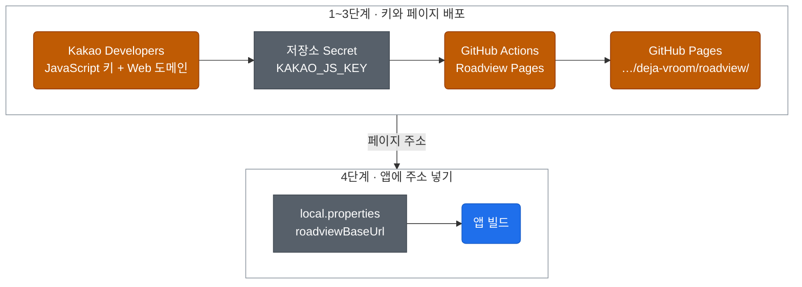

# 로드뷰 설정

후보 카드 썸네일과 후보 로드뷰 화면에 쓸 도로 사진 제공자는 `config/roadview.yml`의 `provider`로 고른다. 앱 코드는 제공자 인터페이스(`RoadViewProvider`)만 알고, 구현체는 설정에 따라 바뀐다. 구조는 [README의 로드뷰 제공자 선택](../README.md#로드뷰-제공자-선택)에 있다.

| `provider` | 보여 주는 것 | 필요한 설정 |
|---|---|---|
| `kakao` (기본) | Kakao 로드뷰 파노라마. `web/roadview/` 페이지를 GitHub Pages에 올리고 WebView로 연다 | 아래 1~4단계 |
| `mapillary` | Mapillary 거리 사진 한 장(CC BY-SA). 앱이 Graph API를 직접 호출한다 | [Mapillary](#mapillary) 절 |
| `demo` | 네트워크 없이 자체 그림 | 없음 |

Kakao로 설정하면 같은 키와 페이지 주소로 장소 검색도 동작한다. [장소 검색 설정](place-search-setup.md)에 따로 넣을 값은 없다.

저장소에는 키와 주소가 들어 있지 않다. 아래 단계대로 각자 채운다. 설정이 비어 있으면 앱은 오류 없이 "로드뷰 주소가 설정되지 않았습니다 · docs/roadview-setup.md 참고" 같은 안내를 보여 준다.

## 0. 제공자 고르기와 우선순위

```yaml
# config/roadview.yml (커밋되는 팀 공통값. 비밀 값은 쓰지 않는다)
provider: kakao
kakao:
  baseUrl: ""
```

같은 항목은 아래 순서로 정해진다. 위가 이긴다.

| 순위 | 위치 | 용도 |
|---|---|---|
| 1 | `./gradlew … -ProadviewProvider=…` 같은 Gradle 속성 | CI·일회성 빌드 |
| 2 | `local.properties` (git 제외) | 각자 Mac의 값, 비밀 값 |
| 3 | `config/roadview.yml` | 팀 공통 기본값 |

`provider`가 `kakao`, `mapillary`, `demo`가 아니면 빌드가 이유를 적고 멈춘다. 값을 바꾼 뒤에는 앱을 다시 빌드한다.

## Kakao

키를 받아 페이지를 배포한 뒤(1~3단계), 그 주소를 앱 빌드에 넣는다(4단계). 주황은 외부 서비스, 회색은 키와 설정 값, 파랑은 앱이다.



### 1. Kakao JavaScript 키와 Web 도메인

1. [Kakao Developers](https://developers.kakao.com) → **내 애플리케이션** → 앱 선택(없으면 **애플리케이션 추가하기**).
2. **앱 설정 → 앱 키**에서 **JavaScript 키**를 복사한다. REST API 키가 아니다.
3. **앱 설정 → 플랫폼 → Web → 사이트 도메인 등록**에 아래를 추가한다.

| 용도 | 도메인 |
|---|---|
| GitHub Pages | `https://<GitHub 계정 또는 조직>.github.io` (이 저장소는 `https://joisfe.github.io`) |
| 로컬 확인 (선택) | `http://localhost:8080` |

도메인에는 경로를 붙이지 않는다(`/deja-vroom/roadview/` 제외).

### 2. 저장소 Secret

GitHub 저장소 → **Settings → Secrets and variables → Actions → New repository secret**

| Name | Secret |
|---|---|
| `KAKAO_JS_KEY` | 1단계의 JavaScript 키 (따옴표·공백 없이) |

Secret이 없거나 형식이 틀리면 워크플로가 `KAKAO_JS_KEY 없음` 또는 `KAKAO_JS_KEY 형식 오류`로 실패한다.

### 3. GitHub Pages

1. 저장소 → **Settings → Pages → Build and deployment → Source**를 **GitHub Actions**로 바꾼다.
2. **Actions → Roadview Pages → Run workflow**로 처음 한 번 배포한다. 이후에는 `main`에서 `web/roadview/**`가 바뀔 때마다 자동으로 배포된다.
3. 실행이 끝나면 요약 화면의 `deploy` 단계에 페이지 주소가 나온다. 이 저장소는 `https://joisfe.github.io/deja-vroom/roadview/`이다.

### 4. 페이지 주소 넣기

팀 공통으로 쓸 주소면 `config/roadview.yml`의 `kakao.baseUrl`에, 내 Mac에서만 바꿀 주소면 저장소 루트의 `local.properties`(git 제외)에 적는다.

```properties
# 앱이 여는 로드뷰 페이지. 3단계의 주소 (config/roadview.yml의 kakao.baseUrl보다 우선)
roadviewBaseUrl=https://joisfe.github.io/deja-vroom/roadview/

# 로컬 서버로 확인할 때만 (선택)
# roadviewBaseUrl=http://localhost:8080/roadview/
# kakaoJsKey=<JavaScript 키>
```

CI처럼 파일을 쓰지 않을 때는 `./gradlew :app:assembleRelease -ProadviewBaseUrl=https://…/roadview/`로 넘긴다. 값을 바꾼 뒤에는 앱을 다시 빌드해야 한다.

| 키 (`local.properties`) | 쓰는 곳 | 비어 있으면 |
|---|---|---|
| `roadviewProvider` | 앱 (`BuildConfig.ROADVIEW_PROVIDER_OVERRIDE`) | `config/roadview.yml`의 `provider` |
| `roadviewBaseUrl` | 앱 (`BuildConfig.ROADVIEW_BASE_URL_OVERRIDE`) | `config/roadview.yml`의 `kakao.baseUrl`. 그것도 비면 설정 안내 |
| `mapillaryClientToken` | 앱 (`BuildConfig.MAPILLARY_CLIENT_TOKEN`) | `provider: mapillary`일 때 설정 안내 |
| `kakaoJsKey` | `scripts/roadview/serve.py` (로컬 확인 전용) | 로컬 페이지가 키 오류를 보여 준다 |

`https` 주소와 `http://localhost`만 받는다. 그 밖의 `http` 주소는 설정되지 않은 것으로 본다.

### 5. 확인 순서

1. **Actions:** Roadview Pages 실행이 초록색인지 본다.
2. **브라우저:** 아래 주소를 연다. 강남역 앞 로드뷰가 보이면 키와 도메인이 맞다.
   ```text
   https://joisfe.github.io/deja-vroom/roadview/?lat=37.497952&lng=127.027619&heading=0
   ```
   썸네일 모드는 같은 주소에 `&thumb=1`을 붙인다.
3. **앱:** 다시 빌드해 설치하고, 목적지 검색 → 복잡 구간 분석 → 후보 카드 썸네일과 후보 로드뷰가 뜨는지 본다.

### 로컬 서버로 확인할 때 (선택)

Pages 배포 전에 페이지를 고치며 확인할 때만 쓴다. 에뮬레이터가 켜진 뒤에 실행한다.

```bash
./scripts/roadview/serve.sh   # 터미널을 연 채로 둔다. adb reverse tcp:8080도 함께 건다
```

`local.properties`의 `roadviewBaseUrl`을 `http://localhost:8080/roadview/`로 바꾸고 debug 빌드로 설치한다. release 빌드는 `http`를 허용하지 않는다.

## Mapillary

Mapillary는 사람들이 올린 거리 사진(CC BY-SA 4.0)이다. 파노라마 대신 경로 방향에 가장 가까운 사진 한 장을 보여 준다. 웹 페이지나 Pages 배포가 필요 없다.

1. [Mapillary 개발자 대시보드](https://www.mapillary.com/dashboard/developers) → **Register application**으로 앱을 등록한다. 권한은 읽기(`read`)만 고른다.
2. 등록한 앱의 **Client Token**(`MLY|…`로 시작)을 복사한다. Client Secret이 아니다.
3. `local.properties`에 적고 `provider`를 바꾼 뒤 다시 빌드한다. `.properties` 파일은 줄 끝 주석을 값으로 읽으니 주석은 따로 줄을 둔다.

```properties
mapillaryClientToken=MLY|<숫자>|<문자열>
# 내 Mac에서만 바꿀 때. 팀 전체는 config/roadview.yml의 provider: mapillary
roadviewProvider=mapillary
```

| 항목 | 내용 |
|---|---|
| 찾는 범위 | 후보 지점 반경 80m |
| 고르는 기준 | 거리(m) + 0.7 × 경로 방향과의 각도 차이(°)가 가장 작은 사진 |
| 화면 표기 | `© Mapillary contributors · CC BY-SA 4.0 · 촬영 <사용자>`, 촬영일, 거리, 방향 차이. 라이선스상 출처 표기를 지우지 않는다 |
| 토큰 노출 | Client Token은 앱에 들어가는 공개용 토큰이다. 그래도 저장소에는 커밋하지 않는다 |

## 문제 해결

| 증상 | 원인 | 해결 |
|---|---|---|
| 앱에 "로드뷰 주소가 설정되지 않았습니다" | `provider: kakao`인데 `roadviewBaseUrl`·`kakao.baseUrl`이 비었거나 형식이 틀림 | Kakao 4단계 후 다시 빌드 |
| "Kakao SDK를 불러오지 못했습니다" | Web 플랫폼에 페이지 도메인이 등록되지 않음 | 1단계 3번. 반영까지 몇 분 걸릴 수 있다 |
| "Kakao JavaScript 키가 페이지에 없습니다" | Secret 누락으로 키 없이 배포됨, 또는 로컬 `kakaoJsKey` 누락 | 2단계 후 워크플로 재실행 / `local.properties` 확인 |
| 워크플로 `KAKAO_JS_KEY 없음` | Secret 미등록 | 2단계 |
| 워크플로 `configure-pages` 단계 실패 | Pages Source가 GitHub Actions가 아님 | 3단계 1번 |
| `net::ERR_CONNECTION_REFUSED` (localhost) | 로컬 모드인데 `serve.sh`가 꺼졌거나, 에뮬레이터 재시작으로 `adb reverse`가 풀림 | `serve.sh` 재실행 또는 `adb reverse tcp:8080 tcp:8080` |
| "Mapillary 토큰이 설정되지 않았습니다" | `provider: mapillary`인데 `mapillaryClientToken`이 빔 | Mapillary 절 3번 |
| "Mapillary 토큰이 거부됐습니다" | Client Secret을 넣었거나 토큰이 폐기됨 | 대시보드에서 Client Token 다시 복사 |
| 빌드가 `provider는 kakao \| mapillary \| demo 중 하나` 로 실패 | `config/roadview.yml` 또는 `roadviewProvider` 오타 | 값 수정 |
| "선택 지점 근처에 Kakao 로드뷰가 없습니다" | 반경 100m 안에 Kakao 로드뷰 촬영 구간이 없음 | 정상 동작. 다른 후보를 고른다 |

## 보안 메모

- Kakao JavaScript 키는 웹 페이지에서 쓰는 공개 키라 배포된 페이지 소스에서 보인다. Kakao가 1단계에 등록한 도메인에서만 동작시키므로, 등록 도메인을 꼭 필요한 것만 둔다.
- 저장소 파일에는 `__KAKAO_JS_KEY__` 자리 표시자만 있다. 실제 키를 커밋하지 않는다.
- `config/roadview.yml`은 커밋되고 APK에 들어간다. 키·토큰은 이 파일에 쓰지 않고 `local.properties`에만 둔다.
