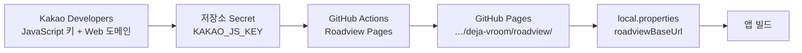

# 로드뷰 설정

후보 카드 썸네일과 후보 로드뷰 화면은 Kakao 로드뷰를 띄우는 웹 페이지(`web/roadview/`)를 앱 안의 WebView로 연다. 이 페이지는 GitHub Pages에 올리고, 앱은 그 주소를 빌드 설정 `roadviewBaseUrl`로 받는다.

저장소에는 키와 주소가 들어 있지 않다. 아래 단계대로 각자 채운다. 설정이 비어 있으면 앱은 오류 없이 "로드뷰 주소가 설정되지 않았습니다 · docs/roadview-setup.md 참고"를 보여 준다.



## 1. Kakao JavaScript 키와 Web 도메인

1. [Kakao Developers](https://developers.kakao.com) → **내 애플리케이션** → 앱 선택(없으면 **애플리케이션 추가하기**).
2. **앱 설정 → 앱 키**에서 **JavaScript 키**를 복사한다. REST API 키가 아니다.
3. **앱 설정 → 플랫폼 → Web → 사이트 도메인 등록**에 아래를 추가한다.

| 용도 | 도메인 |
|---|---|
| GitHub Pages | `https://<GitHub 계정 또는 조직>.github.io` (이 저장소는 `https://joisfe.github.io`) |
| 로컬 확인 (선택) | `http://localhost:8080` |

도메인에는 경로를 붙이지 않는다(`/deja-vroom/roadview/` 제외).

## 2. 저장소 Secret

GitHub 저장소 → **Settings → Secrets and variables → Actions → New repository secret**

| Name | Secret |
|---|---|
| `KAKAO_JS_KEY` | 1단계의 JavaScript 키 (따옴표·공백 없이) |

Secret이 없거나 형식이 틀리면 워크플로가 `KAKAO_JS_KEY 없음` 또는 `KAKAO_JS_KEY 형식 오류`로 실패한다.

## 3. GitHub Pages

1. 저장소 → **Settings → Pages → Build and deployment → Source**를 **GitHub Actions**로 바꾼다.
2. **Actions → Roadview Pages → Run workflow**로 처음 한 번 배포한다. 이후에는 `main`에서 `web/roadview/**`가 바뀔 때마다 자동으로 배포된다.
3. 실행이 끝나면 요약 화면의 `deploy` 단계에 페이지 주소가 나온다. 이 저장소는 `https://joisfe.github.io/deja-vroom/roadview/`이다.

## 4. local.properties

저장소 루트의 `local.properties`(git 제외)에 적는다. 앱은 빌드할 때 이 값을 읽는다.

```properties
# 앱이 여는 로드뷰 페이지 (필수). 3단계의 주소
roadviewBaseUrl=https://joisfe.github.io/deja-vroom/roadview/

# 로컬 서버로 확인할 때만 (선택)
# roadviewBaseUrl=http://localhost:8080/roadview/
# kakaoJsKey=<JavaScript 키>
```

CI처럼 파일을 쓰지 않을 때는 `./gradlew :app:assembleRelease -ProadviewBaseUrl=https://…/roadview/`로 넘긴다. 값을 바꾼 뒤에는 앱을 다시 빌드해야 한다.

| 키 | 쓰는 곳 | 비어 있으면 |
|---|---|---|
| `roadviewBaseUrl` | 앱 (`BuildConfig.ROADVIEW_BASE_URL`) | 앱이 설정 안내 문구를 보여 준다 |
| `kakaoJsKey` | `scripts/roadview/serve.py` (로컬 확인 전용) | 로컬 페이지가 키 오류를 보여 준다 |

`https` 주소와 `http://localhost`만 받는다. 그 밖의 `http` 주소는 설정되지 않은 것으로 본다.

## 5. 확인 순서

1. **Actions:** Roadview Pages 실행이 초록색인지 본다.
2. **브라우저:** 아래 주소를 연다. 강남역 앞 로드뷰가 보이면 키와 도메인이 맞다.
   ```text
   https://joisfe.github.io/deja-vroom/roadview/?lat=37.497952&lng=127.027619&heading=0
   ```
   썸네일 모드는 같은 주소에 `&thumb=1`을 붙인다.
3. **앱:** 다시 빌드해 설치하고, 목적지 검색 → 복잡 구간 분석 → 후보 카드 썸네일과 후보 로드뷰가 뜨는지 본다.

## 로컬 서버로 확인할 때 (선택)

Pages 배포 전에 페이지를 고치며 확인할 때만 쓴다. 에뮬레이터가 켜진 뒤에 실행한다.

```bash
./scripts/roadview/serve.sh   # 터미널을 연 채로 둔다. adb reverse tcp:8080도 함께 건다
```

`local.properties`의 `roadviewBaseUrl`을 `http://localhost:8080/roadview/`로 바꾸고 debug 빌드로 설치한다. release 빌드는 `http`를 허용하지 않는다.

## 문제 해결

| 증상 | 원인 | 해결 |
|---|---|---|
| 앱에 "로드뷰 주소가 설정되지 않았습니다" | `roadviewBaseUrl`이 비었거나 형식이 틀림 | 4단계 후 다시 빌드 |
| "Kakao SDK를 불러오지 못했습니다" | Web 플랫폼에 페이지 도메인이 등록되지 않음 | 1단계 3번. 반영까지 몇 분 걸릴 수 있다 |
| "Kakao JavaScript 키가 페이지에 없습니다" | Secret 누락으로 키 없이 배포됨, 또는 로컬 `kakaoJsKey` 누락 | 2단계 후 워크플로 재실행 / `local.properties` 확인 |
| 워크플로 `KAKAO_JS_KEY 없음` | Secret 미등록 | 2단계 |
| 워크플로 `configure-pages` 단계 실패 | Pages Source가 GitHub Actions가 아님 | 3단계 1번 |
| `net::ERR_CONNECTION_REFUSED` (localhost) | 로컬 모드인데 `serve.sh`가 꺼졌거나, 에뮬레이터 재시작으로 `adb reverse`가 풀림 | `serve.sh` 재실행 또는 `adb reverse tcp:8080 tcp:8080` |
| "선택 지점 근처에 Kakao 로드뷰가 없습니다" | 반경 100m 안에 Kakao 로드뷰 촬영 구간이 없음 | 정상 동작. 다른 후보를 고른다 |

## 보안 메모

- Kakao JavaScript 키는 웹 페이지에서 쓰는 공개 키라 배포된 페이지 소스에서 보인다. Kakao가 1단계에 등록한 도메인에서만 동작시키므로, 등록 도메인을 꼭 필요한 것만 둔다.
- 저장소 파일에는 `__KAKAO_JS_KEY__` 자리 표시자만 있다. 실제 키를 커밋하지 않는다.
