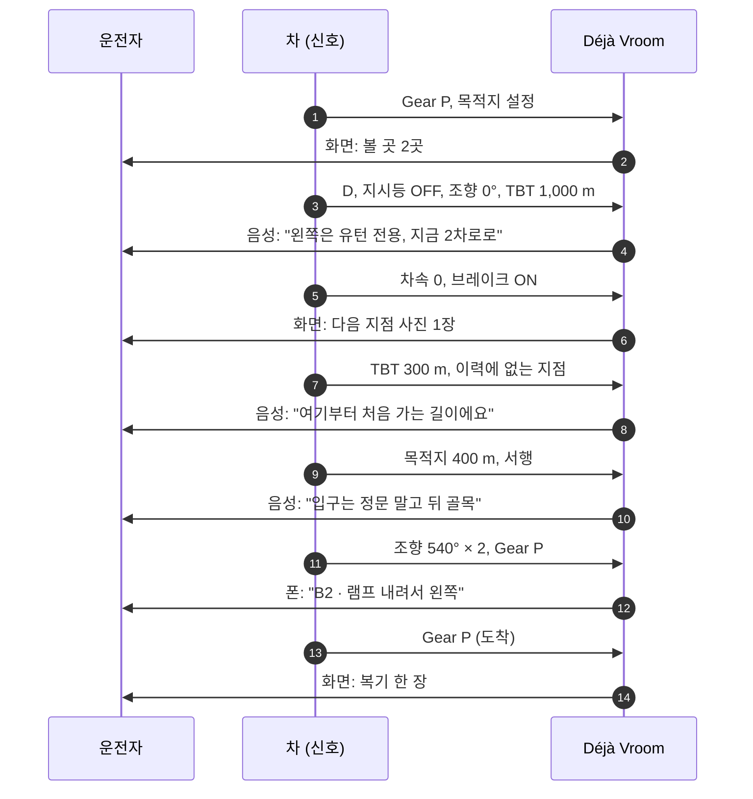

# 시연 시나리오

한 경로를 따라 일곱 장면이 이어져요. 숫자와 장소는 **시나리오 예시**이고, 시연은 Demo 모드의 가짜 데이터로 해요.

**시연 경로:** 성수동 → 분당의 처음 가는 치과, 38 km. 경로의 회전 열두 개 중 볼 곳은 세 곳뿐이에요.

| 지점 | 왜 고르나 |
|---|---|
| ① 성수대교 북단 좌회전 | 운전자들이 헤맨 지점 (깜빡이 → 차선 변경 평균 9초) |
| ② 분당수서로 진출 | 내가 처음 가는 갈림길, 놓치면 12분 돌아감 |
| ③ 치과 주차장 입구 | 이 목적지로 온 차의 31%가 지나쳐 재탐색 |

## 일곱 장면

| # | 시각 · 기어 | 장면 | 앱이 하는 일 | 쓰는 신호 |
|---|---|---|---|---|
| 01 | 08:12 · P | **볼 곳은 둘만** | 회전 열두 개 중 점수 1위와 도착 입구만 보여 줘요. 나머지는 가는 길에 차가 꺼내 줘요 | 목적지, 경로, 이력 |
| 02 | 08:41 · D | **1 km 전, 말로 그림을** | 화면은 내비 그대로 두고 한 문장만 읽어요. 60초 안에 한가한 순간이 없으면 말하지 않아요 | 지시등 OFF, 조향 15° 미만, 다음 TBT 300 m 초과 |
| 03 | 08:46 · D 정차 | **멈추면 한 장만** | 빨간불에 서면 2 km 안의 다음 지점 사진 1장. 출발하면 사라져요 | 차속 0, 브레이크, 다음 지점 거리 |
| 04 | 09:02 · D | **"여기부터 처음이에요"** | 아는 길에서는 끝까지 침묵하다가, 처음 가는 갈림길이 시작되는 순간 한 번만 말해요 | TBT, 위치 이력 대조, 오류 비용 |
| 05 | 09:18 · D | **입구를 지나치지 않게** | 도착 60초 전에 입구를 다시 말하고, 서행하면 사진을 띄워요 | 목적지 거리, 차속, 재탐색 비율 |
| 06 | 09:21 · D → P | **GPS가 죽어도 층은 안다** | 램프에서 핸들이 돈 양으로 층을 세고, P에 넣으면 폰으로 보내요 | 조향각 누적 360°마다 한 층, 기어 |
| 07 | 09:24 · P | **어디서 망설였나** | 지점별 망설인 시간과 아는 길 비율. 다음엔 볼 곳이 입구 하나로 줄어요 | 지시등·조향 타임라인 |

장면 03이 이 앱의 핵심 트릭이에요. "출발 전에 다 외우기"를 "**서 있을 때 다음 것만 보기**"로 바꿨어요.

## Virtual Console 시연 순서

7분, 에뮬레이터 한 대 + 옆에 폰 한 대.

| 단계 | 콘솔 조작 | 보이는 것 | 장면 |
|---|---|---|---|
| 1 | 목적지 설정, Gear P | "볼 곳 둘" 카드 | 01 |
| 2 | ACCEL 60 → TBT 좌회전 1,000 m → Turn Signal OFF, Steering 0° | 한 문장 음성 안내 | 02 |
| 3 | ACCEL 0, Brake ON (Gear D 유지) | 사진 한 장 (허용되지 않으면 음성으로 대체) | 03 |
| 4 | TBT 우회전 300 m | "여기부터 처음이에요" | 04 |
| 5 | 목적지 400 m, ACCEL 15 | 입구 안내 | 05 |
| 6 | Steering 540° × 2, ACCEL 10 → Gear P | "B2", 폰 알림 | 06 |
| 7 | Gear P | 복기: 망설인 14초, 아는 길 100% | 07 |

## 시연 영상

| 영상 | 상태 |
|---|---|
| 에뮬레이터 화면 녹화 (가산점 제출용) | 준비 중. 올라오면 [Discussions](../../../discussions)의 시연 영상 글과 이 표에 링크해요 |
| 숏폼 (30초~1분, 세로) | 선택 |

## 시연 전에 확인할 것

| 항목 | 안 되면 |
|---|---|
| 기어 D 정차 중 이미지 표시가 Pleos 주행 중 제한(DO) 정책에 맞는가 | 장면 03을 음성 묘사로 바꾸고 사진은 P에서만 써요 |
| NaviHelper 재탐색 이벤트를 받을 수 있는가 | 지나침 비율은 시드 데이터로만 시연해요 |
| 조향각 콜백 주기가 층 추정에 충분한가 | 장면 06을 빼요 |
| 로드뷰 이미지를 차량 화면에 쓸 수 있는 약관인가 | 묘사 문장과 직접 만든 도식으로 대체해요 |
