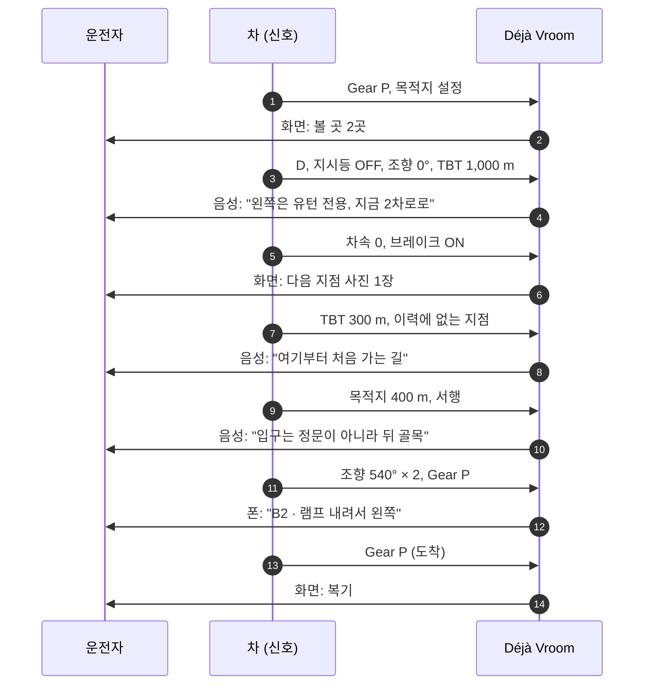

# 시연 시나리오

한 경로에서 일곱 장면이 이어진다. 숫자와 장소는 **시나리오 예시**이며, 시연은 Demo 모드의 가짜 데이터로 한다.

**시연 경로:** 성수동 → 분당의 처음 가는 치과, 38 km. 회전 열두 개 중 볼 곳은 세 곳이다.

| 지점 | 선정 이유 |
|---|---|
| ① 성수대교 북단 좌회전 | 운전자들이 헤맨 지점 (지시등 → 차선 변경 평균 9초) |
| ② 분당수서로 진출 | 처음 가는 갈림길, 놓치면 12분 우회 |
| ③ 치과 주차장 입구 | 이 목적지로 온 차의 31%가 지나쳐 재탐색 |

## 일곱 장면

| # | 시각 · 기어 | 장면 | 앱 동작 | 사용 신호 |
|---|---|---|---|---|
| 01 | 08:12 · P | **볼 곳 두 곳** | 회전 열두 개 중 점수 1위와 도착 입구만 표시한다. 나머지는 주행 중에 꺼낸다 | 목적지, 경로, 이력 |
| 02 | 08:41 · D | **1 km 전 음성 안내** | 화면은 내비 그대로 두고 한 문장만 읽는다. 60초 안에 한가한 순간이 없으면 생략한다 | 지시등 OFF, 조향 15° 미만, 다음 TBT 300 m 초과 |
| 03 | 08:46 · D 정차 | **정차 중 사진 한 장** | 신호 대기 시 2 km 이내 다음 지점 사진 1장. 출발하면 사라진다 | 차속 0, 브레이크, 다음 지점 거리 |
| 04 | 09:02 · D | **처음 가는 구간 진입** | 아는 길에서는 안내하지 않다가, 처음 가는 갈림길이 시작되는 시점에 한 번 안내한다 | TBT, 위치 이력 대조, 오류 비용 |
| 05 | 09:18 · D | **입구 안내** | 도착 60초 전에 입구를 다시 안내하고, 서행하면 사진을 띄운다 | 목적지 거리, 차속, 재탐색 비율 |
| 06 | 09:21 · D → P | **지하 주차 층 추정** | 램프에서 핸들 회전량으로 층을 세고, P 진입 시 폰으로 보낸다 | 조향각 누적 360°당 한 층, 기어 |
| 07 | 09:24 · P | **복기** | 지점별 망설인 시간과 아는 길 비율. 다음 방문 시 볼 곳이 입구 하나로 줄어든다 | 지시등·조향 타임라인 |

핵심은 장면 03이다. "출발 전에 전부 외우기"를 "**정차 중에 다음 지점만 보기**"로 바꾼다.

## Virtual Console 시연 순서

7분, 에뮬레이터 한 대와 폰 한 대.

| 단계 | 콘솔 조작 | 화면 | 장면 |
|---|---|---|---|
| 1 | 목적지 설정, Gear P | "볼 곳 두 곳" 카드 | 01 |
| 2 | ACCEL 60 → TBT 좌회전 1,000 m → Turn Signal OFF, Steering 0° | 한 문장 음성 안내 | 02 |
| 3 | ACCEL 0, Brake ON (Gear D 유지) | 사진 한 장 (불가 시 음성으로 대체) | 03 |
| 4 | TBT 우회전 300 m | "여기부터 처음 가는 길" | 04 |
| 5 | 목적지 400 m, ACCEL 15 | 입구 안내 | 05 |
| 6 | Steering 540° × 2, ACCEL 10 → Gear P | "B2", 폰 알림 | 06 |
| 7 | Gear P | 복기: 망설임 14초, 아는 길 100% | 07 |

## 시연 영상

| 영상 | 상태 |
|---|---|
| 에뮬레이터 화면 녹화 (가산점 제출용) | [media/deja-vroom-demo.mp4](media/deja-vroom-demo.mp4) (3분 17초, 음성·자막). 구간 안내는 [README](../README.md#시연-영상) |
| 숏폼 (30초~1분, 세로) | 선택 |

녹화·설명 음성·자막 생성 스크립트: [scripts/demo-video](../scripts/demo-video/README.md)

## 시연 전 확인 사항

| 항목 | 불가 시 대안 |
|---|---|
| 기어 D 정차 중 이미지 표시가 Pleos 주행 중 제한(DO) 정책에 맞는가 | 장면 03을 음성 안내로 바꾸고 사진은 P에서만 사용 |
| NaviHelper 재탐색 이벤트 수신 가능 여부 | 지나침 비율은 시드 데이터로만 시연 |
| 조향각 콜백 주기가 층 추정에 충분한가 | 장면 06 제외 |
| 로드뷰 이미지의 차량 화면 사용 약관 | 안내 문장과 자체 도식으로 대체 |
