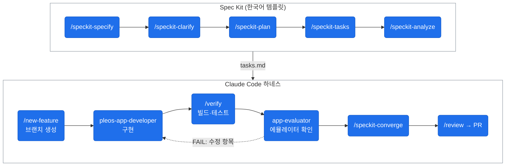

# 개발 흐름

**무엇을, 왜**는 GitHub Spec Kit이 정하고, **어떻게, 언제 완료인지**는 Claude Code 하네스가 정한다.

위 줄이 스펙, 아래 줄이 구현이다. `tasks.md`가 둘을 잇고, 평가가 실패하면 구현으로 돌아간다. 모든 단계는 하네스 명령이나 에이전트라 파랑으로 같다.

현재 `main`에는 `specs/` 디렉터리가 없다. 프로토타입은 스펙 문서 없이 만들었고, 아래 스펙 단계는 아직 적용한 적이 없다.

| 단계 | 명령 · 에이전트 | 산출물 |
|---|---|---|
| 스펙 | `/speckit-specify` → `/speckit-clarify` | `specs/NNN-기능/spec.md` (성공 기준 SC-*) |
| 계획 | `/speckit-plan` (+ `/speckit-checklist`) | `plan.md` |
| 작업 분해 | `/speckit-tasks` → `/speckit-analyze` | `tasks.md` |
| 구현 | `/new-feature specs/NNN-기능` → `pleos-app-developer` | 코드 + 테스트 |
| 검증 | `/verify` | 빌드·테스트 결과 (실패만 보고) |
| 평가 | `app-evaluator` | SC-*별 PASS/FAIL, 스크린샷 |
| 마무리 | `/speckit-converge` → `/review` → PR | 남은 작업, 리뷰 결과 |

## 완료 기준

1. `/verify`가 종료 코드 0으로 끝난다.
2. `app-evaluator`가 에뮬레이터에서 스펙의 성공 기준을 모두 PASS로 확인한다.
3. 리뷰에서 HIGH 지적이 없다.

코드를 읽고 추정으로 완료를 선언하지 않는다.

원칙: [헌법](../.specify/memory/constitution.md) · 하네스 지도: [.claude/README.md](../.claude/README.md)
