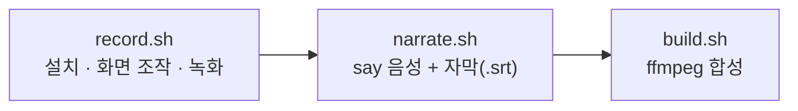

# 시연 영상 만들기

에뮬레이터 화면 녹화에 한국어 설명 음성과 자막을 입혀 `out/deja-vroom-demo.mp4`를 만든다. UI가 바뀌면 같은 명령으로 다시 만든다.



## 준비

| 항목 | 확인 방법 |
|---|---|
| 실행 중인 Pleos 에뮬레이터 | `adb devices`에 기기 1대 |
| macOS 한국어 음성 | `say -v '?' \| grep ko_KR` (기본 `Yuna`, `VOICE=` 로 변경) |
| ffmpeg | `brew install ffmpeg` |
| 네트워크 | 경로 분석이 Nominatim·OSRM을 호출한다 |

## 실행

```bash
scripts/demo-video/build.sh                  # 녹화 + 음성 + 합성
DRY_RUN=1 scripts/demo-video/build.sh        # 실행 없이 단계만 출력
SKIP_RECORD=1 scripts/demo-video/build.sh    # 기존 out/screen.mp4 재사용, 음성만 다시
BURN_CAPTIONS=1 scripts/demo-video/build.sh  # 자막을 영상에 입힌 파일도 생성
```

결과물은 `scripts/demo-video/out/`에 생기며 git에 올리지 않는다.

## 타이밍 고치기

| 바꿀 것 | 파일 |
|---|---|
| 문장, 시작 시각 | `narration.ko.txt` (`시작초\|문장`) |
| 화면 조작 순서, 대기 시간 | `record.sh` 아래쪽 타임라인 (`pause` 값이 문장 시작초와 맞아야 한다) |
| 버튼 문구, 대체 좌표 | `record.sh` 위쪽 config 블록 |

문장이 다음 문장 시작 전에 끝나지 않으면 `narrate.sh`가 WARN을 출력한다. 시작초를 늦추거나 문장을 줄인다.

## 현재 흐름

목적지 화면(기본값 수원시 영통구 → 강남역) → "복잡 구간 분석" → 후보 카드 → "주행 시작". 버튼은 `uiautomator dump`에서 문구로 찾고, 못 찾으면 config의 좌표를 쓴다. Kakao 로드뷰 화면은 키와 로컬 서버가 필요해 넣지 않았다.

## 블라인드 심사

영상, 자막, 음성에 팀원 이름·계정·연락처를 넣지 않는다. 에뮬레이터 상태 표시줄의 계정 알림도 확인한다.
