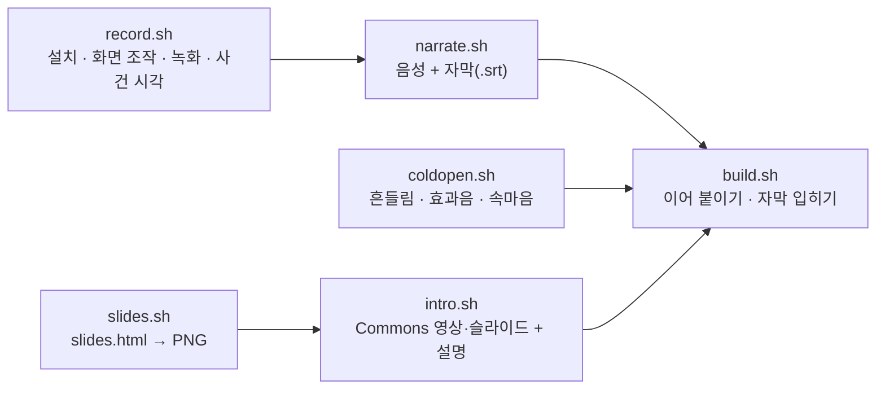

# 시연 영상 만들기

네 부분을 이어 붙이고 한국어 음성과 자막을 입혀 `out/deja-vroom-demo.mp4`를 만든다. UI가 바뀌면 같은 명령으로 다시 만든다.

| 순서 | 부분 | 만드는 스크립트 | 문장 · 장면 |
|---|---|---|---|
| 1 | 첫 장면: 갈림길에서 당황한 운전자 (약 13초) | `coldopen.sh` | `coldopen.ko.txt`, 장면은 스크립트 위쪽 |
| 2 | 인트로: 기획 배경 (약 30초) | `intro.sh` | `intro.ko.txt`, `intro.clips.txt` |
| 3 | 앱 시연: 에뮬레이터 녹화 (약 90초) | `record.sh` → `narrate.sh` | `narration.ko.txt` |
| 4 | 마무리: 첫 장면 갈림길 다시 보기, 2차 개발 내용, 끝인사 (약 60초) | `NAME=next intro.sh` | `next.ko.txt`, `next.clips.txt`, 슬라이드 `slides.html` |



## 준비

| 항목 | 확인 방법 |
|---|---|
| 실행 중인 Pleos 에뮬레이터 | `adb devices`에 기기 1대 |
| 로드뷰 | [로드뷰 설정](../../docs/roadview-setup.md). 로컬 페이지를 쓰면 `scripts/roadview/serve.sh`를 켜 둔다 |
| 한국어 음성 (기본) | `uv tool install edge-tts`. Microsoft 신경망 음성 `ko-KR-InJoonNeural`(남성), 네트워크 필요. `VOICE=ko-KR-SunHiNeural`(여성), `RATE=+10%` 로 변경 |
| 한국어 음성 (오프라인) | `TTS=say` 로 macOS `Yuna` 사용. 기계음에 가깝다 |
| ffmpeg | `brew install ffmpeg` (합성), `brew install ffmpeg-full` (자막 입히기, libass 포함) |
| Google Chrome | 슬라이드 렌더링(`slides.sh`, headless). 다른 위치면 `CHROME=...` |
| 네트워크 | 장소 검색(Kakao)·경로 분석(OSRM), 음성, Commons 영상·효과음 다운로드 |

## 실행

```bash
scripts/demo-video/build.sh                  # 녹화 + 음성 + 첫 장면·인트로·마무리 + 자막
DRY_RUN=1 scripts/demo-video/build.sh        # 실행 없이 단계만 출력
SKIP_RECORD=1 scripts/demo-video/build.sh    # 기존 out/screen.mp4·events.tsv 재사용, 나머지만 다시
INTRO=0 scripts/demo-video/build.sh          # 첫 장면·인트로·마무리 없이 앱 시연만
```

| 결과물 (`out/`) | 내용 |
|---|---|
| `deja-vroom-demo.captioned.mp4` | 자막이 화면에 박힌 영상. 그냥 재생하면 자막이 보인다. 제출·공유용 |
| `deja-vroom-demo.mp4` | 자막 없는 영상 |
| `deja-vroom-demo.srt` | 자막 파일. YouTube 업로드 시 자막으로 올리거나, VLC·IINA에서 영상과 같은 폴더에 두고 연다 (QuickTime은 외부 .srt를 읽지 않는다) |
| `clips/credits.tsv` | 인트로에 쓴 영상의 라이선스와 원본 주소 |

`out/`은 git에 올리지 않는다. 저장소에는 자막 영상을 1080p로 줄인 제출본 `docs/media/deja-vroom-demo.mp4`(약 38MB, GitHub 파일 한도 100MB)와 README 미리보기 그림 `docs/media/deja-vroom-demo.jpg`만 둔다. 영상을 다시 만들면 제출본도 바꾼다.

```bash
ffmpeg -i scripts/demo-video/out/deja-vroom-demo.captioned.mp4 -vf scale=1920:1080:flags=lanczos \
  -c:v libx264 -preset slow -crf 24 -pix_fmt yuv420p -c:a aac -b:a 128k -movflags +faststart docs/media/deja-vroom-demo.mp4
```

## 문장과 타이밍

| 바꿀 것 | 파일 |
|---|---|
| 인트로 문장 | `intro.ko.txt`. 시작이 `+`라 앞 문장에 바로 이어 읽는다 |
| 인트로 장면 | `intro.clips.txt`. 문장 하나에 Commons 영상 한 줄 (`파일 이름\|시작초\|위아래 자를 비율\|끝초`) |
| 앱 시연 문장, 시작 시각 | `narration.ko.txt` (`시작\|자막\|읽을 문장`). 영문 이름처럼 음성이 잘못 읽는 말만 셋째 칸에 한글로 적는다 |
| 말하는 사람 | 넷째 칸. `driver`(운전자 속마음, `ko-KR-SunHiNeural`), `navi`(차 스피커로 나오는 내비 음성). 비우면 해설 |
| 화면 사건에 맞춘 시작 | 시작을 `@orange1+0.2`처럼 쓴다. `record.sh`가 `out/events.tsv`에 카드 열기(`open1`), 주황색 "바로 여기"(`orange1`·`orange2`, 녹화 영상에서 찾은 시각), 다음 지점·목록·주행 시작(`next`·`back`·`drive`)을 남긴다. 로딩 시간이 달라져도 음성이 화면을 따라간다 |
| 화면 조작 순서, 대기 시간 | `record.sh` 아래쪽 타임라인 |
| 2차 개발 슬라이드 | `slides.html`의 `<section id>` 하나가 한 장. `slides.sh`가 headless Chrome으로 `out/slides/<id>.png`를 만든다. 아래 220px은 자막 자리라 비워 둔다 |
| 버튼 문구, 대체 좌표 | `record.sh` 위쪽 config 블록 |

문장 사이 공백은 2초를 넘기지 않는다. `narrate.sh`가 음성 앞뒤 무음을 잘라낸 실제 길이로 재서, 겹치거나 2초 넘게 비면 WARN을 낸다. 비면 문장을 늘리거나 다음 시작초를 당기고, 겹치면 문장을 줄인다. 확인만 할 때는 `scripts/demo-video/narrate.sh 84.5 scripts/demo-video/out/check` 처럼 따로 돌리고 `out/check/cues.tsv`를 본다.

## 영상·효과음 라이선스

영상과 효과음은 Wikimedia Commons의 CC0·퍼블릭 도메인만 쓴다. `fetch-commons.py`가 내려받을 때 라이선스를 확인하고, 다른 라이선스면 멈춘다. 심장 소리와 방향지시등 소리는 ffmpeg로 직접 만든다. 뉴스·유튜브 영상은 공모전 규정(소스·이미지·음원 사용 권한)에 걸리므로 쓰지 않는다. 출처 표기 의무는 없지만, 영상 설명란에 `clips/credits.tsv`의 원본 주소를 적어 두는 것을 권한다. 사고 장면이나 통계 수치는 근거를 확인하기 전에는 넣지 않는다.

| 자료 | 라이선스 | 쓴 곳 |
|---|---|---|
| [Interchange 8 Pohjantie Oulu 20260307.webm](https://commons.wikimedia.org/wiki/File:Interchange_8_Pohjantie_Oulu_20260307.webm) | CC0 | 인트로 첫 장면 (항공 촬영 인터체인지) |
| [Great Eastern Highway and Roe Highway interchange.ogv](https://commons.wikimedia.org/wiki/File:Great_Eastern_Highway_and_Roe_Highway_interchange.ogv) | CC0 | 첫 장면 도로, 마무리의 같은 출구 표지 |
| [Distracted Driving Spot (1018169).webm](https://commons.wikimedia.org/wiki/File:Distracted_Driving_Spot_(1018169).webm) | Public domain | 첫 장면 운전자 실내 (5~8초 구간만) |
| [Dashcam Recording (urban).ogv](https://commons.wikimedia.org/wiki/File:Dashcam_Recording_(urban).ogv) | CC0 | 인트로 도심 주행 |
| [Car Horn.wav](https://commons.wikimedia.org/wiki/File:Car_Horn.wav) | CC0 | 첫 장면 뒤차 경적 |

## 현재 흐름

첫 장면(처음 가는 갈림길에서 내비가 "오른쪽, 이어서 왼쪽"을 말하고, 운전자가 당황하다 뒤차 경적을 듣고 놓치는 장면) → 인트로(망설임이 사고로 이어질 수 있고, 초보 운전자는 로드뷰로 길을 훑어보지 않으면 출발을 못 하기도 한다는 기획 배경) → 앱 시연 → 마무리.

앱 시연: 목적지 화면(광교중앙역 → 현대자동차 양재 본사) → "복잡 구간 분석" → 가는 순서로 놓인 카드 6장을 옆으로 넘겨 보기 → 4번째 카드(용인서울고속도로 진출로)를 눌러 로드뷰 자동 재생(분기점에서 주황색 띠) → "다음 지점"(경부고속도로 양재 진출로) → "목록" → "주행 시작"(미리 본 곳 정리). 분석 버튼은 `uiautomator dump`에서 문구로 찾고, 카드는 문구가 화면에 다 들어올 때까지 넘겨서 누른다. 로드뷰 위 버튼은 dump가 3~6초씩 멈춰서 좌표(2560x1440 에뮬레이터 기준, `NEXT_ROADVIEW_XY` 등으로 덮어쓰기)로 바로 누른다.

마무리: 첫 장면과 같은 출구 표지를 이번엔 흔들림 없이 다시 보며 "여기 아까 본 데다" → 2차 심사까지 개발할 내용(차량 신호로 여유 있는 순간 판단, 1km 전 음성 한 문장, 신호 대기 중 사진 한 장, 도착 직전 주차장 입구, NaviHelper 목적지·회전 안내 연동, 내비 안내 반복하지 않기) → 그다음(헷갈리는 지점 데이터, 운전연수·보험·렌터카) → 끝인사. 2차 내용은 공모 신청서의 주요 기능·사용 시나리오·개발 계획·기대효과와 맞춘다. 슬라이드에는 "2차 심사까지 개발할 내용", "화면 시안"을 적어 지금 동작하는 기능과 구분한다.

경로는 `ORIGIN`·`DESTINATION`(기본 광교중앙역 → 현대자동차 양재 본사)으로 바꾼다. adb로 한글을 입력할 수 없어서, `record.sh`가 설치하는 동안만 `config/search.yml`의 출발지(`source: place`)와 목적지를 바꾸고 설치가 끝나면 원래대로 돌려놓는다. 장소는 Kakao 장소 검색의 첫 결과로 정해진다("현대자동차 양재 본사" → "현대자동차 본사 양재사옥"). 녹화 전에 `pm clear --user current`로 앱 데이터를 지운다. Pleos 에뮬레이터는 운전자 사용자(10)로 앱을 돌려서 `--user`를 빼면 지워지지 않는다. 출발지는 양재 본사까지 17곳을 앱의 선정 로직으로 돌려 골랐다(2026-11-15). 광교중앙역 출발은 고속도로 진출로 세 곳(광교호수로, 용인서울고속도로 한남대교·양재 방면, 경부고속도로 양재 방면)이 이어지고 사진도 모두 나온다. 경로를 바꾸면 `narration.ko.txt`의 장소·지점 이름과 `OPEN_CARD_LABEL`도 함께 고친다.

## 블라인드 심사

영상, 자막, 음성에 팀원 이름·계정·연락처를 넣지 않는다. 에뮬레이터 상태 표시줄의 계정 알림도 확인한다.
